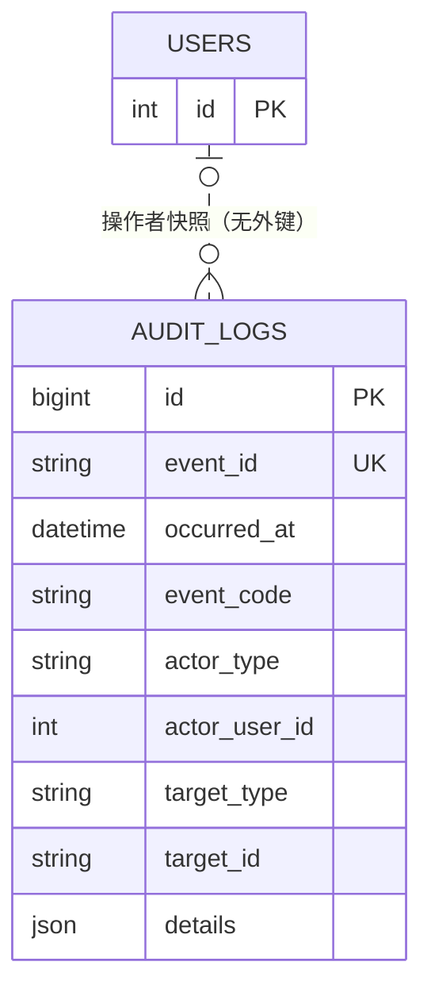

# 1. 需求

## 目标与范围

- 提供统一、追加式的审计事实记录，用于安全追溯、问题排查、复盘和统计。
- 每条记录包含发生时间、事件码、事件概述、结果、操作者、目标、请求关联信息及事件专属 `details`。
- 提供审计记录查询、筛选、受限 CSV 导出与可展示事件目录查询。
- 审计模块不依赖具体业务模块；业务模块只能通过 `AuditService` 写入业务语义事件，不得直接操作 `audit_logs`。

## 非目标与后续阶段

- 审计日志自动清理、独立维护账号及 `AUDIT.LOGS_PURGED` 为后续能力。
- 首期导出为同步 UTF-8 CSV；超出导出上限后的异步任务留待后续设计。
- 既有业务模块可分批接入；接入时须同步定义事件、实现调用和测试。

## 前端 UI 与交互

- 查询页默认按发生时间倒序展示，支持时间范围、事件码、操作者 ID 与用户名筛选。
- 导出页沿用当前筛选条件，明确 CSV 格式和最大导出量；超限时不展示部分结果。
- 事件码目录仅供展示和筛选，前端不得编辑事件定义、结果、原因码或 `details` 规则。

# 2. 技术方案

## 业务规则与实施范围

- `backend/src/audit/eventDefinitions.js` 是事件定义的唯一实现来源，维护分类、摘要、目标策略、允许结果、原因码及 `details` JSON Schema 白名单。本文不复制事件定义。
- 业务模块传入 `eventCode`、`outcome`、`reasonCode`、`target`、`details`；`AuditService` 补充分类、摘要、事件标识、发生时间、操作者及请求快照，校验、脱敏后写入。
- `SUCCESS` 的 `reasonCode` 必须为 `null`；`DENIED`、`FAILURE` 必须使用该事件定义允许的原因码；`details` 必须通过该事件白名单校验。
- 审计记录为追加式事实。普通业务接口不得更新或删除记录；操作者与目标均不设业务外键，以保留用户或目标删除后的历史事实。
- 密码、Token、验证码、授权码及其他敏感字段不得进入审计记录。命中全局敏感键时，`AuditService` 脱敏或移除该值，并只输出不含敏感值的运行告警。

## 数据与接口设计

### 数据模型与 Migration

#### 实体关系

`audit_logs` 保存操作者和目标快照，而非实时实体关联：`actor_user_id` 仅在操作者为用户时记录；`target_type` 与 `target_id` 是多态目标引用。因此两者均不设外键，也不级联删除。



| 关系 | 基数 | 关联字段 | 完整性要求 |
| --- | --- | --- | --- |
| 用户—审计记录（操作者快照） | 一名用户对应零到多条记录；记录也可由匿名或系统产生 | `audit_logs.actor_user_id` 语义上对应 `users.id` | 不设外键；保留用户名快照。 |
| 业务目标—审计记录（多态快照） | 一个业务对象对应零到多条记录 | `target_type` + `target_id` | 不设外键；目标策略与允许目标类型由事件定义约束。 |

#### Migration / SQL

`audit_logs` 的表、唯一约束和查询索引由 Migration `20261031090000-adopt-audit-logs.js` 创建或验证。核心定义如下：

```sql
CREATE TABLE audit_logs (
  id BIGINT UNSIGNED AUTO_INCREMENT PRIMARY KEY,
  event_id CHAR(26) CHARACTER SET ascii COLLATE ascii_bin NOT NULL,
  schema_version TINYINT UNSIGNED NOT NULL DEFAULT 1,
  occurred_at DATETIME(3) NOT NULL,
  event_code VARCHAR(100) CHARACTER SET ascii COLLATE ascii_bin NOT NULL,
  category VARCHAR(32) CHARACTER SET ascii COLLATE ascii_bin NOT NULL,
  outcome VARCHAR(16) CHARACTER SET ascii COLLATE ascii_bin NOT NULL,
  reason_code VARCHAR(100) CHARACTER SET ascii COLLATE ascii_bin NULL,
  actor_type VARCHAR(16) CHARACTER SET ascii COLLATE ascii_bin NOT NULL,
  actor_user_id INT NULL,
  actor_username VARCHAR(100) NULL,
  target_type VARCHAR(32) CHARACTER SET ascii COLLATE ascii_bin NULL,
  target_id VARCHAR(128) NULL,
  request_id VARCHAR(64) NULL,
  ip VARCHAR(45) NULL,
  user_agent TEXT NULL,
  details JSON NOT NULL,
  CONSTRAINT uq_audit_logs_event_id UNIQUE (event_id),
  INDEX idx_audit_occurred_at (occurred_at),
  INDEX idx_audit_event_time (event_code, occurred_at),
  INDEX idx_audit_actor_time (actor_user_id, occurred_at),
  INDEX idx_audit_target_time (target_type, target_id, occurred_at),
  INDEX idx_audit_request_id (request_id),
  INDEX idx_audit_category_outcome_time (category, outcome, occurred_at)
);
```

#### 建模说明

- `event_id` 是 ULID 格式的稳定事件标识；`id` 是内部主键；`occurred_at` 由服务端以 UTC 生成。
- `event_code`、`category`、`outcome`、`reason_code` 与 `details` 的合法组合由事件定义校验，不在数据库重复维护一份规则。
- 查询索引按时间、事件、操作者、目标和请求标识设置，覆盖查询、导出与排障场景。

### 后端 Service 契约

Controller 只处理 HTTP 鉴权、输入校验和响应映射；业务模块不得直接使用 `AuditLog` Model。

| Service | 核心职责 | 事务与审计要求 |
| --- | --- | --- |
| `AuditService` | 校验、脱敏并写入审计事件；构造公共字段。 | 高风险成功变更必须与审计记录使用同一事务提交。 |
| `AuditQueryService` | 校验筛选、分页查询、生成受限 CSV 数据。 | 只读；默认按 `occurredAt DESC, id DESC` 排序。 |
| `AuditExportService` | 编排导出、成功/失败审计与返回文件前的失败处理。 | 成功审计写入失败时不得返回文件；失败审计独立记录。 |
| `AuditEventDefinitionService`（只读） | 返回可展示的事件码、分类和摘要。 | 读取 `eventDefinitions.js`；不暴露或修改内部白名单。 |

#### Service 方法与参数

| Service 方法 | 输入 | 返回 | 业务错误 | 说明 |
| --- | --- | --- | --- | --- |
| `AuditService.record(auditContext, command, { transaction })` | `AuditContext`、`AuditEventCommand`、可选事务 | 审计记录 | `AuditValidationError` | 唯一允许的审计写入入口。 |
| `AuditQueryService.list(query)` | `AuditLogQuery` | `AuditLogPage` | `AUDIT_QUERY_INVALID` | 分页查询。 |
| `AuditQueryService.exportCsv(filters)` | `AuditLogFilters` | `{ csv, rowCount, filters }` | `AUDIT_QUERY_INVALID`、`AUDIT_EXPORT_LIMIT_EXCEEDED` | 生成完整 CSV，超限不截断。 |
| `AuditExportService.exportCsv(auditContext, filters)` | `AuditContext`、`AuditLogFilters` | `{ csv, rowCount, filters }` | 同上 | 导出流程的唯一应用入口；记录成功或业务失败审计。 |
| `AuditEventDefinitionService.listPublic()` | 无 | `AuditEventDefinition[]` | 无 | 返回可公开展示的事件目录。 |

| 类型                  | 字段                                                    | 类型                  | 必填  | 约束与语义                                   |
| ------------------- | ----------------------------------------------------- | ------------------- | --- | --------------------------------------- |
| `AuditContext`      | `actor`、`requestId`、`ip`、`userAgent`                  | object              | 是   | 由 API、任务或消息入口构造，调用方不得伪造。                |
| `AuditEventCommand` | `eventCode`、`outcome`、`reasonCode`、`target`、`details` | object              | 是   | 所有字段必须符合对应事件定义。                         |
| `AuditLogFilters`   | `from`、`to`                                           | UTC ISO 8601 / null | 否   | 时间范围为 `[from, to)`；同时存在时必须 `from < to`。 |
| `AuditLogFilters`   | `eventCode`                                           | string / null       | 否   | 精确匹配，服务端标准化为大写。                         |
| `AuditLogFilters`   | `actorUserId`、`actorUsername`                         | string / null       | 否   | 分别为精确匹配和不区分大小写的包含匹配。                    |
| `AuditLogQuery`     | `page`、`limit`                                        | positive integer    | 否   | 默认 `1`、`20`；`limit` 最大 `100`。           |

#### 跨模块业务规则

| 业务规则 | 负责 Service / 调用方 | 事务与并发控制 | 不满足时的结果 |
| --- | --- | --- | --- |
| 高风险成功业务变更与审计事实原子提交 | 业务 Service + `AuditService` | 使用同一数据库事务 | 审计写入失败时回滚业务变更。 |
| 导出成功或业务失败记录导出事件 | `AuditExportService` | 发送 HTTP 响应前写入；失败记录可独立提交 | 成功审计失败时不发送文件。 |
| 业务模块不得绕过 `AuditService` 写表 | 所有业务 Service | 代码结构与评审约束 | 视为实现违规。 |

### 授权决策

```text
请求
  ├─ 无 Bearer Token、Token 无效或过期       → 401 UNAUTHORIZED
  ├─ 用户不存在或已停用                       → 403 FORBIDDEN
  └─ 有效启用用户
       ├─ 有 audit:read   → ALLOW 查询/事件目录
       ├─ 有 audit:export → ALLOW 导出
       └─ 其他情况         → 403 FORBIDDEN
```

- `audit:read` 与 `audit:export` 由 API 路由与 OpenAPI 声明；前端不构成安全边界。
- 导出权限只代表可进入导出流程；筛选无效或数量超限仍分别返回 `400` 或 `422`。

### HTTP API 契约

OpenAPI 是唯一 API 契约来源：[openapi.yaml](../../backend/openapi/openapi.yaml)、[paths/audit.yaml](../../backend/openapi/paths/audit.yaml)、[schemas/audit.yaml](../../backend/openapi/schemas/audit.yaml)。

| 接口 | 所需权限 | Path / Query 参数 | 请求体 | 成功响应 |
| --- | --- | --- | --- | --- |
| `GET /api/audit-logs` | `audit:read` | `from`、`to`、`eventCode`、`actorUserId`、`actorUsername`、`page`、`limit` | 无 | `AuditLogPage`。 |
| `POST /api/audit-logs/export` | `audit:export` | 无 | `{ filters: AuditLogFilters, format: "csv" }` | UTF-8 CSV 文件流。 |
| `GET /api/audit-event-definitions` | `audit:read` | 无 | 无 | `{ items: AuditEventDefinition[] }`。 |

- 查询默认按 `occurredAt DESC, id DESC`；事件码精确匹配，用户名为不区分大小写的包含匹配。
- 导出上限为环境变量 `AUDIT_EXPORT_MAX_ROWS`，默认 `10000`；超限返回 `422 AUDIT_EXPORT_LIMIT_EXCEEDED`。
- 事件目录接口仅返回事件码、分类和摘要，不返回事件专属 Schema 或允许原因码。

## 权限与安全

### 本功能涉及的权限

| 权限码 | 使用场景 | 校验位置 |
| --- | --- | --- |
| `audit:read` | 查询审计记录和事件目录 | 审计查询 API 路由。 |
| `audit:export` | 导出 CSV | 审计导出 API 路由。 |

### 安全约束

- 审计记录不提供普通业务 API 的修改或删除能力；运行账户只需 `SELECT`、`INSERT`，清理任务启用时使用受控的独立维护账户。
- 响应、CSV 与运行日志不得包含密码、Token、验证码、授权码、异常堆栈或未脱敏敏感字段。
- API 不接受客户端直接创建任意审计事件；`details` 仅经 `AuditService` 校验和脱敏后存储。

## 审计与运行日志

审计模块自身只列举其负责产生的事件；其他业务动作的审计清单在各功能文档中维护，并以 `eventDefinitions.js` 为最终依据。

| 业务动作 | 事件码 | 何时记录 | 审计目标 |
| --- | --- | --- | --- |
| 导出审计记录成功 | `AUDIT.LOGS_EXPORTED` | CSV 生成后、发送 HTTP 响应前 | 无（目标策略为 `NONE`） |
| 导出超过上限或生成失败 | `AUDIT.LOGS_EXPORTED` | 确定业务失败后 | 无（目标策略为 `NONE`） |

- 成功使用 `SUCCESS` 与 `reasonCode: null`；超限使用 `FAILURE` / `AUDIT.EXPORT_LIMIT_EXCEEDED`，生成失败使用 `FAILURE` / `AUDIT.EXPORT_GENERATION_FAILED`。
- 请求格式或筛选参数无效时返回 `400 AUDIT_QUERY_INVALID`，且不记录导出审计事件；审计查询不额外写审计事件。

# 3. 验收标准与测试

- Migration 在空测试数据库创建完整表、唯一约束和查询索引；已有但不兼容的表必须明确失败，不得静默删除数据。
- 单元测试覆盖事件、结果、原因码、目标类型、`details` 白名单和敏感字段脱敏。
- 单元测试覆盖筛选参数、时间范围、分页、默认排序、CSV 转义与导出上限。
- 集成测试覆盖 `401`、`403`、查询筛选、OpenAPI 响应结构及导出成功/超限/生成失败。
- 集成测试验证导出事件在响应前写入，高风险业务变更与成功审计记录原子提交；审计写入失败时业务变更回滚。
- 查询、导出与运行日志均不得泄露敏感凭据或未经脱敏的敏感字段。
