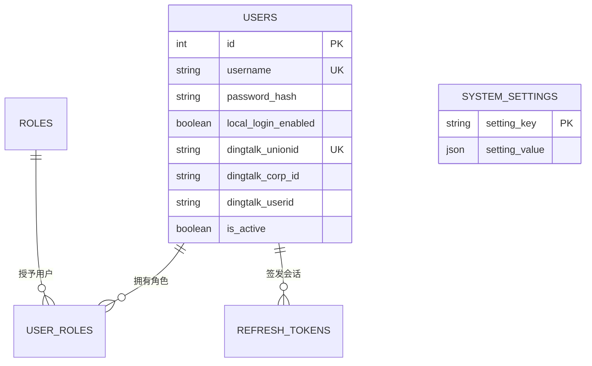

# 1. 需求

## 目标与范围

- 系统以 Logtool 内部 `users` 账户作为唯一业务主体；钉钉仅是外部身份提供方。业务数据、角色、权限和会话均关联内部用户 ID，而不直接依赖钉钉字段。
- 本功能负责“你是谁、能否建立或维持会话”：账户身份绑定、登录、登出、令牌刷新、账户启用状态校验、登录安全防护和认证审计。
- 本功能不负责“你能做什么”：角色、权限计算与授权仍由 RBAC 的 `AuthorizationService` 负责；用户资料和本地登录资格的管理、全局登录开关的修改分别属于账户管理和系统配置功能。
- 普通用户的默认登录方式为钉钉。服务端在每次钉钉认证后验证其企业为配置的 `dingtalk_corp_id`；通过后首次登录自动创建并绑定内部账户，后续登录复用该账户。
- 本地用户名密码登录同时受全局开关和用户 `local_login_enabled` 控制。全局开关关闭时，普通用户不能用本地密码；超级管理员仍可从独立的应急入口登录，但也必须是已指定可本地登录的账户。
- 不提供公开注册、忘记密码或自助创建超级管理员。首位超级管理员由部署 Bootstrap 创建；后续仅能由已有超级管理员授予 `super_admin` 角色，或经受控运维流程创建可登录账户。
- 本地密码必须满足：至少 8 位，且含大写字母、小写字母与数字；不得与用户名相同；不得存在连续 4 个及以上相同字符。
- 已停用（`is_active=false`）的账户不得使用任何登录方式；本地密码锁定不影响钉钉登录。
- 登录页按浏览器语言选择默认文案，允许手动切换语言。

### 关键判定

`local_login_enabled` 是按账户的额外许可，不能仅以全局开关替代：普通用户本地登录须同时满足“全局已开启 + 用户已启用本地登录”；应急入口须同时满足“用户已启用本地登录 + 有效 `super_admin` 角色”。新建钉钉用户默认 `false`。本期只消费此设置；由后续账户/系统配置能力提供受控的配置与授权入口。

## 非目标与后续阶段

- 不做钉钉外的第三方身份提供方、账号合并/解绑、自助密码重置、MFA 和跨企业账号。
- 不在本期提供“修改全局本地登录开关”或“为用户开通本地登录”的管理 UI/API；它们属于系统配置和账户管理功能，但其持久化模型与受控 Service 边界在本设计中预留。
- 不迁移、继续暴露或兼容旧的 `POST /api/auth/register` 公开注册语义；该接口应下线并在 OpenAPI 中移除。
- 不信任钉钉返回的昵称、手机号作为身份匹配依据；昵称仅用于展示，手机号不写入本功能模型。

## 前端 UI 与交互

- 普通登录页默认显示“钉钉登录”（免登或扫码由钉钉 SDK/页面能力取得一次性 `authCode`）。仅当 `GET /api/auth/login-options` 返回 `localLoginEnabled=true` 时显示普通“用户名/密码”表单。
- 页面底部提供低显著性的“管理员应急登录”链接，进入独立页面；该页始终显示本地账号表单，但服务端而非前端决定该账户是否为可本地登录的超级管理员。
- 连续失败达到 3 次后的下一次提交起，前端调用验证码接口并要求填写验证码；接口响应中的 `requireCaptcha` 是唯一判断依据。锁定时展示服务端返回的剩余秒数，不显示账户是否存在。
- 两类本地登录失败均使用泛化提示（凭据无效、验证码错误、暂时锁定、当前方式不可用），不得泄露用户是否存在、是否是超级管理员、是否已绑定钉钉或账号状态。
- 钉钉认证失败、非目标企业、账户停用均回到登录页并给出可本地化的通用失败提示；不得把授权码、access token 或钉钉原始响应展示或记录到浏览器日志。

# 2. 技术方案

## 数据与接口设计

### 数据模型与 Migration

#### 实体关系



| 关系 | 基数 | 关联字段 | 完整性要求 |
| --- | --- | --- | --- |
| 用户—角色 | 多对多 | `user_roles.user_id` → `users.id` | 复用 RBAC 定义；首次钉钉建户通过 `UserRoleService.assignDefaultRole` 分配 `user`。 |
| 用户—刷新令牌 | 一对多 | `refresh_tokens.user_id` → `users.id` | 复用现有会话模型；停用账户时，认证 Service 必须拒绝并撤销其活动会话。 |
| 钉钉企业用户—内部用户 | 零或一对一 | `users.dingtalk_corp_id` + `users.dingtalk_userid` | 联合唯一；`dingtalk_unionid` 如存在也全局唯一。 |

#### Migration / SQL

以新的、可重复执行的 Migration 演进已有 `users`，不得依赖 `sequelize.sync` 或手工 DDL；对历史脏数据或冲突绑定明确失败并给出修复清单，绝不静默覆盖。

```sql
ALTER TABLE users
  MODIFY password_hash VARCHAR(255) NULL,
  ADD COLUMN local_login_enabled TINYINT(1) NOT NULL DEFAULT 0,
  ADD COLUMN dingtalk_corp_id VARCHAR(128) NULL,
  ADD COLUMN dingtalk_bound_at DATETIME(3) NULL;

ALTER TABLE users
  MODIFY dingtalk_unionid VARCHAR(128) NULL,
  MODIFY dingtalk_userid VARCHAR(128) NULL,
  ADD CONSTRAINT uq_users_dingtalk_corp_user
    UNIQUE (dingtalk_corp_id, dingtalk_userid);

CREATE TABLE system_settings (
  setting_key VARCHAR(100) NOT NULL PRIMARY KEY,
  setting_value JSON NOT NULL,
  updated_at DATETIME(3) NOT NULL
);

INSERT INTO system_settings (setting_key, setting_value, updated_at)
VALUES ('auth.local_login_enabled', JSON_OBJECT('enabled', false), UTC_TIMESTAMP(3));
```

- `username` 保持全局唯一；钉钉首次建户由服务端生成 `dd_` 加 ULID（例如 `dd_01K7H9QX4M7J2A8P6R3T`），数据库唯一约束是最终防线。不得以钉钉 `userId`、手机号或昵称拼接用户名。
- `dingtalk_corp_id` 和 `dingtalk_userid` 必须成对出现；MySQL `UNIQUE` 对 `NULL` 的语义不足以表达这一规则，`DingtalkIdentityService` 在写入前校验，Migration 对历史半绑定记录失败或先行修复。
- 旧字段 `dingtalk_mobile` 不再用于认证或新写入。本期不立即物理删除，待完成数据清理和消费者排查后在后续 Migration 移除。
- 配置值的修改必须由未来的 `SystemConfigService` 在事务中校验并审计；认证流程只读配置，路由和控制器不得直接读写 `system_settings`。
- 目标企业 ID 为部署配置 `DINGTALK_CORP_ID`，必须非空；它不是可由 Migration 预置的租户数据。启动校验和 `getLoginOptions()` 均须在未配置时返回受控的 `AUTH_CONFIGURATION_INVALID`，钉钉登录不得降级放行。

### 后端 Service 契约

控制器仅负责速率限制接入、HTTP 输入校验、构造 `AuditContext` 和响应映射；不得查询 `User`、写 `refresh_tokens` 或直接调用钉钉 HTTP。所有认证路径统一由 `AuthenticationService` 完成账户状态校验、会话签发编排与审计。

#### 模块边界

| 模块 | 本功能的职责/依赖 | 明确不承担的职责 |
| --- | --- | --- |
| 账户与认证 | 登录方式编排、钉钉身份绑定、密码校验、会话、刷新与登出、认证安全防护和认证审计。 | 用户资料编辑、账户启停、本地登录资格授予、系统配置写入。 |
| RBAC | 通过 `AuthorizationService` 返回有效角色、超级管理员标记和权限；为应急登录提供超级管理员判定。 | 校验密码、签发令牌、钉钉身份绑定或记录认证失败计数。 |
| 账户管理 | 创建受控本地账户、修改资料、启停账户、授予/撤销 `local_login_enabled`。 | 绕过 `AuthenticationService` 登录或直接写刷新令牌、认证审计。 |
| 系统配置 | 维护 `auth.local_login_enabled`；向认证功能提供只读配置。 | 直接处理 HTTP 登录请求或替代账户级登录资格校验。 |

- 账户管理停用账户时，须调用 `AuthenticationService.revokeUserSessions(userId, auditContext)`，在同一业务事务中撤销该用户的刷新令牌；认证功能继续在每次登录、刷新和受保护请求的用户解析处检查 `is_active`。
- 账户管理创建或启用本地账户时，密码哈希只可通过 `CredentialService.setLocalPassword(userId, rawPassword, auditContext)` 写入；该 Service 统一执行密码策略、bcrypt 哈希和相关审计，调用方不得直接更新 `password_hash`。

| Service | 核心职责 | 事务与审计要求 |
| --- | --- | --- |
| `AuthenticationService` | 执行普通本地登录、应急管理员登录、钉钉登录和登出；统一校验账户启用状态、登录资格、生成会话。 | 钉钉首次建户、默认角色分配和成功登录审计同一事务；会话创建与成功审计同一事务。 |
| `DingtalkIdentityClient` | 用一次性 `authCode` 向钉钉换取可信身份，并返回 `corpId`、`unionId`、`userId`、`nick`。 | 外部调用；不记录授权码/令牌；超时、错误码映射为受控领域错误。 |
| `DingtalkIdentityService` | 验证目标企业，按绑定标识查找或创建内部账户，维护允许变更的展示绑定字段。 | 锁定候选绑定行；处理唯一键竞争后重新读取；不以手机号匹配。 |
| `LocalLoginGuardService` | 实现用户名失败次数、验证码、15 分钟锁定及按 IP 的一分钟限流。 | 使用 Redis 原子 `INCR`/TTL；Redis 不可用时本地登录失败关闭（返回 `503 AUTH_GUARD_UNAVAILABLE`），不得绕过保护。 |
| `AuthSessionService` | 签发/轮换/撤销访问令牌和刷新令牌，并设置刷新 Token、CSRF Cookie。 | 复用现有令牌轮换模型；令牌原文绝不落库或进入审计。 |
| `SystemConfigService` | 返回并校验认证相关全局配置。 | 认证流程只读；配置变更由所属功能负责授权、事务和审计。 |

#### Service 方法与业务规则

| Service 方法 | 输入 | 返回 | 业务错误 |
| --- | --- | --- | --- |
| `AuthenticationService.loginLocal(command, auditContext)` | `username`、`password`、验证码、`rememberMe` | `LoginResult` | `INVALID_CREDENTIALS`、`CAPTCHA_REQUIRED`、`CAPTCHA_INVALID`、`LOCAL_LOGIN_DISABLED`、`ACCOUNT_INACTIVE`、`LOCAL_LOGIN_NOT_ALLOWED`、`LOGIN_LOCKED` |
| `AuthenticationService.loginEmergency(command, auditContext)` | 同上 | `LoginResult` | 同上，另有 `EMERGENCY_LOGIN_FORBIDDEN` |
| `AuthenticationService.loginDingtalk(command, auditContext)` | `authCode`、`rememberMe` | `LoginResult` | `DINGTALK_AUTH_FAILED`、`DINGTALK_CORP_FORBIDDEN`、`ACCOUNT_INACTIVE` |
| `AuthenticationService.logout(session, auditContext)` | 已认证会话 | 无 | `UNAUTHORIZED` |
| `AuthenticationService.getLoginOptions()` | 无 | `LoginOptions` | 无 |

| 业务不变量/规则 | 负责 Service | 事务与并发控制 | 不满足时的结果 |
| --- | --- | --- | --- |
| 钉钉账户必须属于配置企业 | `DingtalkIdentityService` | 外部响应验证后、任何查找/写入前 | `DINGTALK_CORP_FORBIDDEN`；不创建账户。 |
| 一次钉钉身份只能绑定一个内部账户 | `DingtalkIdentityService` | 以唯一约束最终保证；唯一键冲突后重新查询 | 绑定冲突返回受控失败并记录运行告警。 |
| 首次钉钉登录创建内部账户并分配普通角色 | `DingtalkIdentityService` + `UserRoleService` | 单一数据库事务 | 任一步失败则回滚账户、角色和成功审计。 |
| 本地登录资格 | `AuthenticationService` | 登录前读取全局配置、账户字段和有效授权 | 普通入口不符合返回 `LOCAL_LOGIN_DISABLED`/`LOCAL_LOGIN_NOT_ALLOWED`；应急入口非超级管理员返回 `EMERGENCY_LOGIN_FORBIDDEN`。 |
| 停用账号禁止一切认证和令牌刷新 | `AuthenticationService`、刷新流程 | 每次登录与刷新均检查 `is_active` | 新认证拒绝；撤销刷新令牌；返回 `ACCOUNT_INACTIVE`。 |
| 密码防护只影响本地密码认证 | `LocalLoginGuardService` | Redis 原子计数；以规范化用户名为失败键 | 3 次后要求验证码；第 5 次失败起锁 15 分钟；钉钉登录不读取该状态。 |
| 本地认证 IP 限流 | `LocalLoginGuardService` | `auth:local-login:ip:{sha256(ip)}:{minute}`，原子计数且 TTL 120 秒 | 超过 20 次/分钟返回 `429 LOCAL_LOGIN_RATE_LIMITED` 和 `Retry-After`。 |

- 用户名按 Unicode 规范化并去除首尾空白后用于查找、失败计数和审计目标；密码、验证码、`authCode`、Cookie、JWT 与刷新令牌不得被记录。
- 本地密码校验使用 bcrypt；`password_hash IS NULL` 的账户在本地路径统一视为凭据无效，不得将空值传给 bcrypt。
- 密码验证成功后立即清除该用户名的失败/锁定状态；验证码使用一次性、短 TTL 的随机挑战，不计入审计 `details`。
- 钉钉扫码与免登均必须由同一个 `DingtalkIdentityClient` 得到含企业标识的标准身份；无法取得或验证 `corpId` 时默认拒绝，不能降级为只校验 `unionId`。

### 授权决策

```text
匿名登录请求
  ├─ 本地普通入口：全局本地登录关闭                 → 403 LOCAL_LOGIN_DISABLED
  ├─ 本地应急入口：非启用超级管理员或未获本地许可    → 403 EMERGENCY_LOGIN_FORBIDDEN
  ├─ 钉钉身份不属于目标企业                          → 403 DINGTALK_CORP_FORBIDDEN
  ├─ 已解析内部用户但 is_active=false                → 403 ACCOUNT_INACTIVE
  └─ 认证凭据、密码、验证码、锁定与限流校验通过      → 签发会话

已认证请求
  ├─ 无效/过期凭据                                  → 401 UNAUTHORIZED
  ├─ 用户不存在或 is_active=false                    → 403 FORBIDDEN
  └─ 由 RBAC AuthorizationService 判定业务权限       → ALLOW / 403
```

- 登录与登录选项接口是匿名接口，不使用 RBAC 权限码；应急入口的超级管理员判断是认证过程的业务规则，而非“已有 JWT 后”的路由权限。
- 登录成功后由 `AuthorizationService.getAuthorization(user.id)` 返回角色和有效权限；前端据此控制可见性，但所有受保护 API 仍由后端强制鉴权。

### HTTP API 契约

OpenAPI 新增 `paths/auth.yaml`、`schemas/auth.yaml` 并在 `openapi.yaml` 引用；所有字段为 camelCase，错误响应遵循 `api-conventions.md`。

| 接口 | 鉴权 | 请求 | 成功响应 | 主要失败 |
| --- | --- | --- | --- | --- |
| `GET /api/auth/login-options` | 无 | 无 | `{ dingtalkEnabled, localLoginEnabled, emergencyLoginEnabled }` | `503 AUTH_CONFIGURATION_INVALID` |
| `POST /api/auth/local-login` | 无 | `LocalLoginRequest` | `LoginResult`，并设置刷新/CSRF Cookie | `401 INVALID_CREDENTIALS`；`403` 登录方式/账户限制；`423 LOGIN_LOCKED`；`429` 限流；`503` 防护不可用 |
| `POST /api/auth/emergency-login` | 无 | `LocalLoginRequest` | 同上 | 同本地登录；非应急管理员为 `403 EMERGENCY_LOGIN_FORBIDDEN` |
| `POST /api/auth/dingtalk-login` | 无 | `{ authCode, rememberMe }` | `LoginResult` | `400 DINGTALK_AUTH_FAILED`；`403 DINGTALK_CORP_FORBIDDEN`/`ACCOUNT_INACTIVE` |
| `GET /api/auth/captcha` | 无 | 无 | `{ captchaId, svg }` | `503 AUTH_GUARD_UNAVAILABLE` |
| `POST /api/auth/refresh` | CSRF + 刷新 Cookie | 无 | `{ token }` | `401 UNAUTHORIZED`；`403 ACCOUNT_INACTIVE` |
| `POST /api/auth/logout` | CSRF + 刷新 Cookie | 无 | `204` | `401 UNAUTHORIZED` |
| `GET /api/auth/me` | Bearer | 无 | `AuthenticatedUser` | `401 UNAUTHORIZED`；`403 FORBIDDEN` |

- `LocalLoginRequest`：`username`（1–100）、`password`（1–256）、`captchaId`/`captchaCode`（需要验证码时必填）和可选 `rememberMe`。密码字段仅可写，绝不出现在任一响应 Schema。
- `LoginResult`：`token`、`user`、`mustChangePassword`；`user` 包含 `id`、`username`、`email`、`authorization`。钉钉自动创建账户的 `mustChangePassword=false`。
- 移除 `POST /api/auth/register`。旧 `POST /api/auth/login`、`POST /api/auth/dingtalk/login` 要么在同一主版本内保留为无语义变化的短期别名，要么在发布时返回 `410 AUTH_ENDPOINT_RETIRED`；最终路径必须在 OpenAPI 标记迁移期限，不能出现文档与实现不一致。

## 权限与安全

### 涉及权限

本功能的匿名登录接口无 RBAC 权限码。认证成功后的授权数据复用 `GET /api/me/authorization` 与 RBAC 的 `super_admin` 判定；后续管理“本地登录开通”和“全局开关”时必须定义独立权限码，不能复用普通用户管理权限。

### 安全约束

- 钉钉 `authCode` 为一次性敏感凭据，服务端只经 HTTPS 发送给官方接口；不写运行日志、审计、异常响应、消息队列或浏览器存储。
- `DingtalkIdentityClient` 必须限定 TLS 校验、连接/读取超时、官方主机白名单及响应字段校验；外部服务故障不得回显原始错误。
- 刷新令牌仅以哈希落库，通过 `HttpOnly`、`Secure`（生产强制）、合适 `SameSite` Cookie 传输；刷新和登出要求双提交 CSRF Token。访问令牌不写审计。
- 本地登录的 IP 使用可信反向代理配置后的客户端地址；不得盲信任任意 `X-Forwarded-For`。Redis 键仅保存散列 IP 和计数。
- 认证响应、审计、运行日志和异常映射均禁止包含密码哈希、原始密码、验证码答案、钉钉授权码、第三方 access token、JWT、刷新令牌和完整 Cookie。

## 审计与运行日志

事件必须先添加到 `backend/src/audit/eventDefinitions.js`，由 `AuditService.record` 写入。匿名失败审计的 `actorType=ANONYMOUS`；成功登录的 `actorType=USER` 且目标为用户。审计 `details` 只记录下表白名单字段，均不含敏感凭据。

| 业务动作 | 事件码 | 结果/原因码 | 审计目标 | details 白名单 |
| --- | --- | --- | --- | --- |
| 本地普通登录 | `AUTH.LOCAL_LOGIN` | `SUCCESS`；`DENIED`：`INVALID_CREDENTIALS`、`CAPTCHA_INVALID`、`LOGIN_LOCKED`、`LOCAL_LOGIN_DISABLED`、`LOCAL_LOGIN_NOT_ALLOWED`、`ACCOUNT_INACTIVE` | 已识别用户时为 `USER`，否则无目标 | `loginChannel: "local"`、`captchaRequired` |
| 应急管理员登录 | `AUTH.EMERGENCY_LOGIN` | `SUCCESS`；`DENIED`：上述适用原因及 `EMERGENCY_LOGIN_FORBIDDEN` | 已识别用户时为 `USER`，否则无目标 | `loginChannel: "emergency"`、`captchaRequired` |
| 钉钉登录 | `AUTH.DINGTALK_LOGIN` | `SUCCESS`；`DENIED`：`DINGTALK_AUTH_FAILED`、`DINGTALK_CORP_FORBIDDEN`、`ACCOUNT_INACTIVE` | 已绑定/创建的 `USER`，否则无目标 | `loginChannel: "dingtalk"`、`accountCreated` |
| 登出 | `AUTH.LOGOUT` | `SUCCESS` | `USER` | `sessionRevoked: true` |

- 凭据格式错误和 IP 限流在进入认证业务前返回，可仅输出脱敏运行指标，不写高基数审计记录，避免攻击者放大审计存储；此行为需在事件定义与接口测试中固定。
- 成功登录的会话持久化与成功审计原子提交；若审计写入失败则撤销/回滚新会话并返回通用失败。认证被拒绝的审计使用独立短事务，审计不可用时返回通用失败且产生无敏感信息的运行告警。

# 3. 验收标准与测试

- Migration 集成测试从空库和代表性历史库运行，验证 `password_hash` 可空、钉钉绑定唯一约束、默认本地登录配置、初始值及冲突历史数据的明确失败行为。
- `AuthenticationService` 单元测试覆盖本地/应急/钉钉三条路径、密码强度、账户停用、普通用户与超级管理员资格、默认角色分配、会话签发和审计命令。
- `DingtalkIdentityService` 单元测试覆盖企业不匹配、缺少企业标识、已有绑定、首次绑定、并发首次登录唯一键竞争和禁止手机号匹配。
- `LocalLoginGuardService` 单元测试覆盖第 3 次失败后要求验证码、第 5 次失败后锁 15 分钟、成功清计数、验证码一次性、每 IP 20 次/分钟、Redis 不可用时失败关闭，以及锁定不阻止钉钉登录。
- HTTP 集成测试覆盖所有 OpenAPI 请求/响应、`400/401/403/423/429/503` 错误映射、Cookie/CSRF、刷新令牌轮换、停用后刷新被拒绝、旧公开注册不可用及 API 文档一致性。
- 审计集成测试验证每个事件的结果/原因码/details Schema、匿名与用户 actor、成功认证与审计的原子性，并扫描审计/响应/日志夹具确认不含密码、验证码、授权码或 Token。
- 前端端到端测试覆盖浏览器语言初始化和手动切换、登录方式按 `login-options` 展示、应急入口、验证码及锁定提示、钉钉失败回退，以及前端不以自身逻辑作为授权边界。
