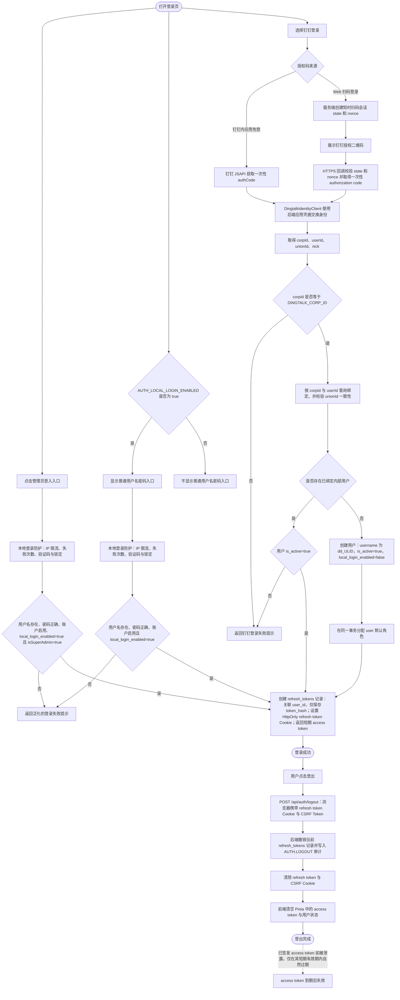
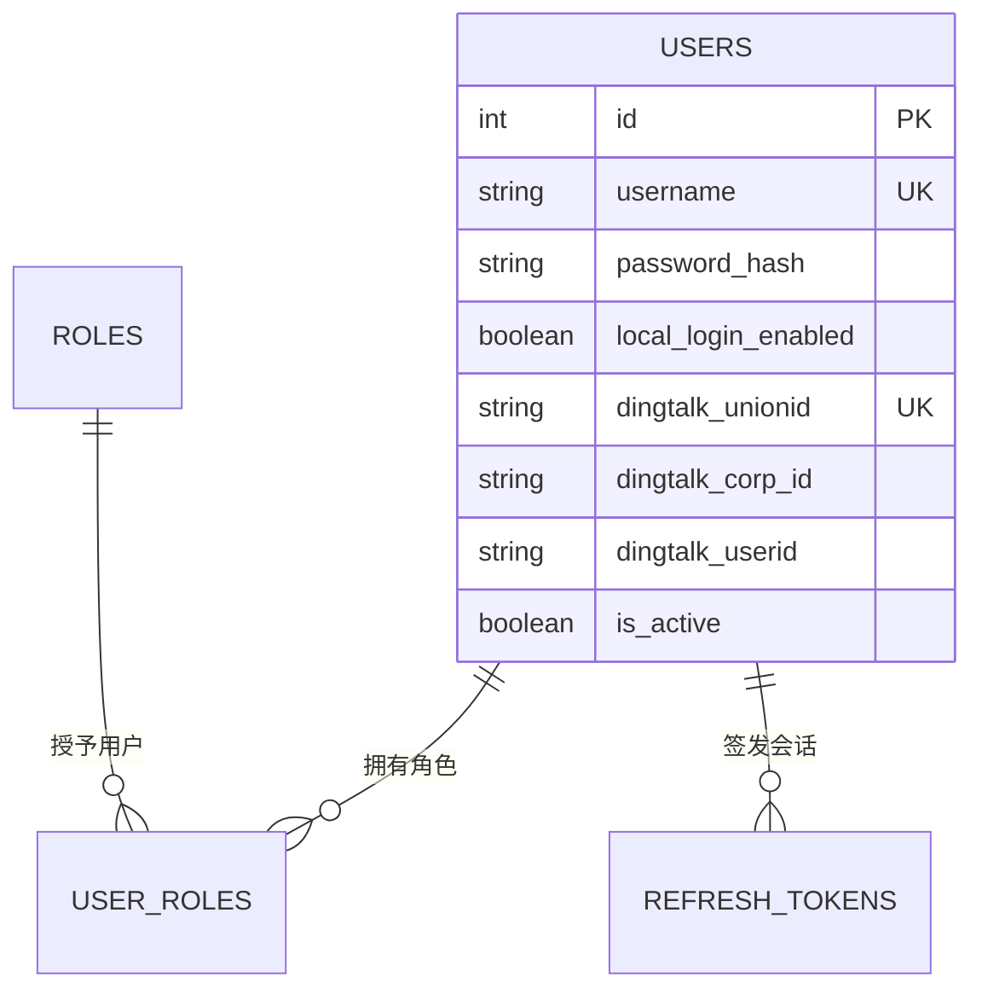

# 1. 需求

## 目标与范围

- 登入方式，默认不启用用户名密码登入，只保留钉钉登入的方式
	普通用户以钉钉作为默认登录方式。只有属于已配置钉钉企业的人员可以登录，以钉钉的企业成员管理能力限制企业外人员访问系统。
	通过钉钉认证的人员首次登录后，系统自动创建并绑定其 Logtool 账户；后续登录进入同一账户。停用账户不能通过钉钉或本地密码登录。
	本期不建立旧 Logtool 账户与钉钉身份的绑定或合并关系。旧账户仅为保留历史业务数据而保留；在已确认存在新的可用超级管理员后，可通过受控运维流程停用旧账户，但不得删除。
	系统保留用户名密码登录，但普通用户是否可使用该方式由后端环境变量 `AUTH_LOCAL_LOGIN_ENABLED` 控制：变量为 `false` 时，登录页不显示普通用户名密码入口，服务端也拒绝普通用户名密码登录；为 `true` 时才可使用。
	保留独立的超级管理员应急登录入口，位于普通登录页底部。该入口不受普通用户本地登录全局开关影响，只有指定的超级管理员可以使用用户名密码登录，点击管理员登入入口后跳转到独立的管理员登入界面；
	不提供公开注册、忘记密码或自助创建超级管理员。首位超级管理员由部署 Bootstrap 创建；后续仅能由已有超级管理员授予 `super_admin` 角色，或经受控运维流程创建可登录账户。
- 默认不启用用户名密码登入的方式，但保留功能
- 登入认证要求
	钉钉作为默认登录方式，只有属于已配置钉钉企业的人员可以登录，在钉钉内创建了应用入口后免密登入；
	如果使用Web端登入，支持钉钉扫描登入
	用户名密码登入场景下本地密码必须满足：至少 8 位，且含大写字母、小写字母与数字；不得与用户名相同；不得存在连续 4 个及以上相同字符。
		本地密码连续失败 3 次后，下一次提交起必须填写验证码；
		连续失败 5 次后，锁定该用户名的本地密码登录 15 分钟。
		同一 IP 每分钟最多提交 20 次本地登录请求。
		密码锁定不影响钉钉登录。
		登录失败时应提供明确且不暴露账号安全信息的提示；
		用户名密码登入的情况下是怎么实现保持登入状态的，目前实现的效果并不好；

- 登录页根据浏览器语言显示默认语言，用户可手动切换语言。

## 非目标与后续阶段

- 不做钉钉外的第三方身份提供方、账号合并/解绑、自助密码重置、MFA 和跨企业账号。
- 不在本期提供“修改全局本地登录开关”或“为用户开通本地登录”的管理 UI/API。全局开关通过部署环境变量配置；用户级许可字段只由 Bootstrap 或受控运维流程写入。
- 旧字段 `dingtalk_mobile` 不再用于认证或新写入。本期不立即物理删除，待完成数据清理和消费者排查后在后续 Migration 移除。
## 前端 UI 与交互

- 登入页面无需背景，扫码登入和用户名密码登入以tab的方式切换，表单部分在页面种居中显示
- 普通登录页默认显示“钉钉扫码登录”。仅当开启了用户名密码登入后才显示普通“用户名/密码”输入的表单，与钉钉扫码形成两个TAB。
- 页面底部提供低显著性的“管理员登录”链接，跳转到一个独立的管理员登入页面，该页面仅有用户名密码表单，输入用户名密码的表单和开启用户名密码的表单前端样式一致；
- 连续失败达到 3 次后的下一次提交起，前端调用验证码接口并要求填写验证码，连续失败5次后提示，锁定时展示服务端返回的剩余秒数，不显示账户是否存在。
- 登录失败返回的提示信息应是泛化的提示信息，不得泄露用户是否存在、是否是超级管理员、是否已绑定钉钉或账号状态。
	如果密码错误、用户名不存在这一类问题都提示 “用户名或密码错误”
	如果是账户未激活状态，尝试登入，“用户名或密码错误”
	验证码缺失	“请完成验证码验证”
	验证码错误	“验证码错误，请重试”
	连续失败已锁定	“登录尝试次数过多，请 15 分钟后重试”
	IP 限流	“请求过于频繁，请稍后再试”
	非超级管理员尝试应急入口	“用户名或密码错误”
- 登录页根据浏览器语言显示默认语言，用户可手动切换语言。
# 2. 技术方案

## 整体方案

- 系统以 Logtool 内部 `users` 账户作为唯一业务主体；钉钉是外部身份提供方。业务数据、角色、权限和会话均关联内部用户 ID，而不直接依赖钉钉字段。
- 本功能负责“你是谁、能否建立或维持会话”：账户身份绑定、登录、登出、令牌刷新、账户启用状态校验、登录安全防护和认证审计。
- 本功能不负责“你能做什么”：角色、权限计算与授权由 RBAC 的 `AuthorizationService` 负责；用户资料和本地登录资格的管理、全局登录开关的修改分别属于账户管理和系统配置功能。
- `AUTH_LOCAL_LOGIN_ENABLED` 是后端部署环境变量，作为普通本地登录的全局总开关；`local_login_enabled` 是数据库中的账户级登录许可字段，不能仅以全局开关替代：普通本地登录须同时满足“环境变量为 `true` + 用户已启用本地登录”；应急入口须同时满足“用户已启用本地登录 + 有效 `super_admin` 角色（`isSuperAdmin=true`）”。新建钉钉用户默认 `false`，本期不提供维护接口，只消费该设置；指定应急管理员由 Bootstrap 或受控运维流程设置该字段。
- 不提供公开注册的入口，旧的公开注册语义不再保留：`POST /api/auth/register` 下线并从 OpenAPI 移除。钉钉昵称只用于展示，手机号不参与身份匹配，也不在本功能中新写入。
- 采用 JWT Access Token + 有状态 Refresh Token 的双令牌认证
	access token 是 JWT：后端用签名和有效期验证，通常不查数据库，属于“近似无状态”。默认有效期为 15 分钟。
	refresh token 是随机字符串：后端在 refresh_tokens 表保存其哈希、用户 ID、有效期和撤销状态，属于“有状态”。
	普通 refresh token 有效期为 7 天，勾选“记住我”为 30 天；每次刷新均轮换 refresh token，属于 Refresh Token Rotation。
```
	登录成功 → access token 写入 Pinia state
	刷新页面 → 内存清空
         → 浏览器自动用 HttpOnly Cookie 中的 refresh token 请求 /auth/refresh
         → 获得新的 access token 写回内存
```

### 登录全流程



- `AUTH_LOCAL_LOGIN_ENABLED` 只控制普通用户名密码入口，不影响钉钉登录和管理员应急入口；即使它为 `true`，钉钉登录仍应始终可选。
- 图中的“返回失败”不得泄露用户名是否存在、密码是否正确、是否为超级管理员或是否已绑定钉钉，泛化的提示信息
- 登出不签发或刷新 refresh token；它撤销当前 refresh token 并清除浏览器 Cookie。access token 不落库，客户端清空后不再正常使用；若令牌已泄露，最长只会在其短期有效期内继续有效。

### 钉钉认证流程

支持钉钉登入多种方式，Web端扫描登入、钉钉内应用免密登入；钉钉内免登与 Web 扫码登录共用同一个后端认证流程；两者仅在一次性授权码的获得方式不同。钉钉应用凭据（`clientId`/`appKey`、`clientSecret`/`appSecret`）只配置在后端，前端不得持有、传输或记录。

```text
钉钉内免登
  已登录钉钉客户端
    → 前端调用钉钉 JSAPI，取得一次性 authCode

Web 扫码登录
  前端请求 POST /api/auth/dingtalk/qr-session
    → 服务端生成 state、nonce 和短时扫码会话，并返回钉钉授权 URL/二维码参数
  登录页展示钉钉二维码
    → 用户使用钉钉扫描并确认
    → 钉钉通过已登记的 HTTPS 回调地址返回 authorization code 与 state
    → 服务端校验 state、nonce、过期时间、一次性使用状态及发起浏览器会话

统一后端流程
  authCode / authorization code
    → DingtalkIdentityClient 使用后端应用凭据向钉钉交换身份
    → 得到并校验 corpId、userId、unionId、nick
    → 验证 corpId 等于 DINGTALK_CORP_ID
    → DingtalkIdentityService 创建或读取 Logtool 内部账户
    → AuthenticationService 签发 Logtool access token 与 refresh token
```

- 钉钉内免登的 `authCode` 短时且只能使用一次；前端仅在取得后立即提交给 `POST /api/auth/dingtalk-login`，不得持久化、打印到控制台或写入运行日志。扫码回调的 `authorization code` 仅由后端处理。
- Web 扫码必须使用钉钉应用后台登记的 HTTPS 回调地址。扫码会话存于 Redis 或服务端会话，包含 `state`、`nonce`、发起浏览器会话标识、过期时间和已使用标识；回调必须原子地消费该会话，防止登录 CSRF、授权码替换与重复回调。
- 扫码回调成功后由后端设置 refresh 与 CSRF Cookie，并重定向至前端“登录完成”路由；该路由从可读取的 CSRF Cookie 取得值并调用 `/api/auth/refresh`，将返回的 access token 写入内存后进入系统。回调 URL、重定向 URL、`code` 与 `state` 均不得留在浏览器历史或前端日志中。
- 无法从钉钉身份响应中获得并验证 `corpId` 时，认证必须失败；不得仅依据 `unionId`、`userId`、昵称或手机号放行。
- `DingtalkIdentityClient` 屏蔽钉钉不同应用类型、SDK 和接口的差异，对 `AuthenticationService` 只返回标准化身份 `{ corpId, userId, unionId, nick }`。外部错误统一映射为领域错误，不回显钉钉原始响应。

## 数据与接口设计

### 数据模型与 Migration

#### 实体关系



| 关系          | 基数    | 关联字段                                               | 完整性要求                                                              |
| ----------- | ----- | -------------------------------------------------- | ------------------------------------------------------------------ |
| 用户—角色       | 多对多   | `user_roles.user_id` → `users.id`                  | 复用 RBAC 定义；首次钉钉建户通过 `UserRoleService.assignDefaultRole` 分配 `user`。 |
| 用户—刷新令牌     | 一对多   | `refresh_tokens.user_id` → `users.id`              | 复用现有会话模型；停用账户时，认证 Service 必须拒绝并撤销其活动会话。                            |
| 钉钉企业用户—内部用户 | 零或一对一 | `users.dingtalk_corp_id` + `users.dingtalk_userid` | 联合唯一；`dingtalk_unionid` 如存在也全局唯一。                                  |

#### Migration / SQL

以新的、可重复执行的 Migration 演进已有 `users`，不得依赖 `sequelize.sync` 或手工 DDL；对历史脏数据或冲突绑定明确失败并给出修复清单，绝不静默覆盖。

```sql
ALTER TABLE users
  MODIFY password_hash VARCHAR(255) NULL,
  ADD COLUMN local_login_enabled TINYINT(1) NOT NULL DEFAULT 0,
  ADD COLUMN dingtalk_corp_id VARCHAR(128) NULL,
  ADD COLUMN dingtalk_bound_at DATETIME(3) NULL;

ALTER TABLE users
  MODIFY dingtalk_unionid VARCHAR(128) NULL,
  MODIFY dingtalk_userid VARCHAR(128) NULL,
  ADD CONSTRAINT uq_users_dingtalk_unionid UNIQUE (dingtalk_unionid),
  ADD CONSTRAINT uq_users_dingtalk_corp_user
    UNIQUE (dingtalk_corp_id, dingtalk_userid),
  ADD CONSTRAINT ck_users_dingtalk_identity_pair CHECK (
    (dingtalk_corp_id IS NULL AND dingtalk_userid IS NULL)
    OR (dingtalk_corp_id IS NOT NULL AND dingtalk_userid IS NOT NULL)
  );
```

- `username` 保持全局唯一；钉钉首次建户由服务端生成 `dd_` 加 ULID（例如 `dd_01K7H9QX4M7J2A8P6R3T`），数据库唯一约束是最终防线。不得以钉钉 `userId`、手机号或昵称拼接用户名。
- `dingtalk_corp_id` 和 `dingtalk_userid` 必须成对出现；MySQL `UNIQUE` 对 `NULL` 的语义不足以表达这一规则，`DingtalkIdentityService` 在写入前校验，Migration 对历史半绑定记录失败或先行修复。
- `dingtalk_bound_at` 只在首次成功建立钉钉绑定时写入；后续登录不得覆盖。目标数据库若不支持强制执行 `CHECK` 约束，Migration 必须在启动前检测并拒绝部署，不能把该规则降级为仅靠约定。
- `AUTH_LOCAL_LOGIN_ENABLED` 与 `DINGTALK_CORP_ID` 均为部署环境变量：启动时由 `AuthConfiguration` 读取并校验，路由、控制器和前端不得自行解释或覆盖。变更变量需通过受控部署流程完成，不适用数据表维护；认证配置的变量清单和安全默认值见 `backend/.env.example`，各业务模块只通过 `src/config/auth.js` 或 `src/config/dingtalk.js` 读取，不直接访问 `process.env`。
- 目标企业 ID 为部署配置 `DINGTALK_CORP_ID`，必须非空；它不是可由 Migration 预置的租户数据。启动校验和 `getLoginOptions()` 均须在未配置时返回受控的 `AUTH_CONFIGURATION_INVALID`，钉钉登录不得降级放行。

#### 认证环境变量分组

`backend/.env.example` 是认证配置的基线模板；实际 `.env` 仅保存部署取值，禁止提交密钥。变量按职责分组如下：

| 分组         | 变量                                                                                                                  | 说明                                                                                                         |
| ---------- | ------------------------------------------------------------------------------------------------------------------- | ---------------------------------------------------------------------------------------------------------- |
| 本地认证开关     | `AUTH_LOCAL_LOGIN_ENABLED`                                                                                          | 只控制普通用户名密码入口；不影响钉钉与应急管理员入口。                                                                                |
| 会话与 Cookie | `JWT_SECRET`、`ACCESS_TOKEN_TTL`、`REFRESH_TOKEN_*`、`AUTH_COOKIE_*`、`CSRF_COOKIE_NAME`                                | JWT 签名、令牌生命周期和浏览器 Cookie 安全属性。生产环境必须使用随机 `JWT_SECRET` 并启用 `AUTH_COOKIE_SECURE=true`。                       |
| 本地认证防护     | `AUTH_LOGIN_RATE_LIMIT_PER_MINUTE`、`AUTH_LOGIN_CAPTCHA_THRESHOLD`、`AUTH_LOGIN_LOCK_*`                               | 仅影响用户名密码登录的限流、验证码和锁定策略。                                                                                    |
| 刷新令牌清理     | `REFRESH_TOKEN_CLEANUP_*`                                                                                           | 控制过期令牌及已撤销令牌保留期的后台清理任务。                                                                                    |
| 钉钉免登       | `DINGTALK_CORP_ID`、`DINGTALK_APP_KEY`、`DINGTALK_APP_SECRET`                                                         | 企业 ID 和服务端应用凭据；仅供后端 Adapter 使用。                                                                            |
| 钉钉扫码（预留）   | `DINGTALK_WEB_CLIENT_ID`、`DINGTALK_WEB_CLIENT_SECRET`、`DINGTALK_WEB_REDIRECT_URI`、`DINGTALK_QR_SESSION_TTL_SECONDS` | 扫码 Adapter 完成后启用。旧变量 `DINGTALK_APP_ID`、`DINGTALK_WEB_APP_SECRET`、`DINGTALK_LOGIN_REDIRECT` 暂兼容读取，完成迁移后应删除。 |

#### 认证环境变量参考

下表是 `backend/.env.example` 中变量的完整说明。`.env` 只填写实际取值，绝不提交仓库；`replace-me`、空值和示例地址均不能直接用于生产。代码默认值以 `src/config/auth.js`、`src/config/dingtalk.js` 为准。

**运行、数据库与 Redis**

| 变量 | 示例/默认值 | 含义与部署要求 |
| --- | --- | --- |
| `NODE_ENV` | `development` | 运行环境。生产使用 `production`；它会使未显式配置的 `AUTH_COOKIE_SECURE` 默认开启。 |
| `PORT` | `3000` | 后端 HTTP 监听端口。通常仅在容器或反向代理内部暴露。 |
| `DB_HOST` | `127.0.0.1` | MySQL 主机地址。生产应使用内网地址或受控数据库服务。 |
| `DB_PORT` | `3306` | MySQL 端口。 |
| `DB_NAME` | `logtool` | 数据库名称。Migration 在此数据库中记录执行历史。 |
| `DB_USER` | `logtool` | 数据库应用账户。应遵循最小权限原则，不使用 root。 |
| `DB_PASSWORD` | 无默认值 | 数据库密码，属于密钥；生产从密钥管理服务或受保护的部署变量注入。 |
| `CACHE_ENABLED` | `true` | 是否连接 Redis。只要开放本地用户名密码登录就必须为 `true`，否则登录保护会按设计拒绝服务；钉钉登录本身不依赖它。 |
| `REDIS_URL` | `redis://127.0.0.1:6379` | Redis 连接 URL。生产使用带认证的受保护连接；使用 TLS 时使用 `rediss://`。当前配置以它为唯一推荐写法。 |

**本地登录与会话**

| 变量 | 默认值 | 含义、取值与生产建议 |
| --- | --- | --- |
| `JWT_SECRET` | 无；缺失时无法签发 access token | JWT 签名密钥。使用足够长的高随机值；轮换会使现有 access token 失效，不能写入前端、日志或仓库。 |
| `AUTH_LOCAL_LOGIN_ENABLED` | `false` | `true` 才显示并允许普通用户名密码登录；`false` 时仍允许钉钉登录和独立的应急管理员入口。用户级 `local_login_enabled` 仍须同时为 `true`。 |
| `ACCESS_TOKEN_TTL` | `15m` | access token 有效期，采用 JWT 可识别的时长字符串，如 `15m`、`1h`。应保持较短，推荐 15 分钟。 |
| `REFRESH_TOKEN_TTL` | `7d` | 未勾选“记住我”时 refresh token 有效期。过期后用户重新认证。 |
| `REFRESH_TOKEN_REMEMBER_TTL` | `30d` | 勾选“记住我”时 refresh token 有效期。应显著长于普通 refresh token，但不宜无限期。 |
| `REFRESH_COOKIE_NAME` | `rt` | 存放 refresh token 原文的 HttpOnly Cookie 名称；只可改名，不能改为由前端存储 token。 |
| `CSRF_COOKIE_NAME` | `csrf_token` | 存放 CSRF 随机值的可读 Cookie 名称；前端在刷新和登出时将同一值带入请求头，后端做双提交校验。 |
| `AUTH_COOKIE_SECURE` | `NODE_ENV=production` 时为 `true`，否则 `false` | `true` 时 Cookie 只经 HTTPS 传输。生产必须显式设为 `true`；本地 HTTP 开发可设 `false`。 |
| `AUTH_COOKIE_SAMESITE` | `lax` | Cookie 跨站策略，只接受 `lax`、`strict`、`none`，其他值回退为 `lax`。一般使用 `lax`；`none` 必须配合 `AUTH_COOKIE_SECURE=true`，且需评估跨站架构与 CSRF 风险。 |

**本地用户名密码防护**

| 变量 | 默认值 | 含义、取值与生产建议 |
| --- | --- | --- |
| `AUTH_LOGIN_RATE_LIMIT_PER_MINUTE` | `20` | 单个 IP 每分钟最多可提交的本地登录次数。正整数；超过后返回限流响应。 |
| `AUTH_LOGIN_CAPTCHA_THRESHOLD` | `3` | 同一用户名累计失败到达该次数后，下一次本地登录开始要求验证码。正整数。 |
| `AUTH_LOGIN_LOCK_THRESHOLD` | `5` | 同一用户名累计失败到达该次数后锁定本地密码登录。正整数，且应不小于验证码阈值。 |
| `AUTH_LOGIN_LOCK_TTL_SECONDS` | `900` | 上述锁定的持续秒数，默认 15 分钟。只影响本地密码登录，不影响钉钉认证。 |

**刷新令牌清理**

| 变量 | 默认值 | 含义、取值与生产建议 |
| --- | --- | --- |
| `REFRESH_TOKEN_CLEANUP_DISABLED` | `false` | 是否关闭后台清理任务。生产通常保持 `false`；关闭会使 `refresh_tokens` 表持续累积。 |
| `REFRESH_TOKEN_CLEANUP_INTERVAL_MIN` | `60` | 清理任务的运行间隔（分钟），必须为正整数。 |
| `REFRESH_TOKEN_CLEANUP_STARTUP_DELAY_SEC` | `45` | 服务进程启动后首次执行清理前等待的秒数，避免与启动期资源竞争。 |
| `REFRESH_TOKEN_REVOKED_RETENTION_DAYS` | `30` | 已撤销 token 的保留天数。保留期内可识别轮换令牌重放；不应短于安全审计调查所需周期。已过期 token 在清理时直接删除。 |

**钉钉认证**

| 变量 | 默认值 | 含义与部署要求 |
| --- | --- | --- |
| `DINGTALK_CORP_ID` | 无 | 允许登录的钉钉企业 ID。钉钉认证启用时必须配置；身份响应的 `corpId` 必须与它完全一致。 |
| `DINGTALK_APP_KEY` | 无 | 钉钉内部应用的 AppKey / Client ID，仅后端用于免登身份交换。属于受保护配置。 |
| `DINGTALK_APP_SECRET` | 无 | 钉钉内部应用密钥，仅后端持有，绝不发送到浏览器、日志或审计记录。 |
| `DINGTALK_WEB_CLIENT_ID` | 无 | Web 扫码 OAuth 应用的 Client ID。扫码 Adapter 完成前仅作预留。 |
| `DINGTALK_WEB_CLIENT_SECRET` | 无 | Web 扫码 OAuth 应用密钥；仅后端持有。 |
| `DINGTALK_WEB_REDIRECT_URI` | 无 | 钉钉应用后台登记的 HTTPS 回调地址，必须与后台登记值完全一致。 |
| `DINGTALK_QR_SESSION_TTL_SECONDS` | `300` | Web 扫码会话及 `state`/`nonce` 的有效期（秒），默认 5 分钟。 |

旧变量 `DINGTALK_APP_ID`、`DINGTALK_WEB_APP_SECRET`、`DINGTALK_LOGIN_REDIRECT` 只为现有部署迁移而兼容。新部署不得再设置它们；待现有部署改用 `DINGTALK_WEB_*` 后删除兼容代码。

### 后端 Service 契约

控制器仅负责速率限制接入、HTTP 输入校验、构造 `AuditContext` 和响应映射；不得查询 `User`、写 `refresh_tokens` 或直接调用钉钉 HTTP。所有认证路径统一由 `AuthenticationService` 完成账户状态校验、会话签发编排与审计。

#### 模块边界

| 模块 | 本功能的职责/依赖 | 明确不承担的职责 |
| --- | --- | --- |
| 账户与认证 | 登录方式编排、钉钉身份绑定、密码校验、会话、刷新与登出、认证安全防护和认证审计。 | 用户资料编辑、账户启停、本地登录资格授予、系统配置写入。 |
| RBAC | 通过 `AuthorizationService` 返回有效角色、超级管理员标记和权限；为应急登录提供超级管理员判定。 | 校验密码、签发令牌、钉钉身份绑定或记录认证失败计数。 |
| 账户管理 | 创建受控本地账户、修改资料和启停账户。 | 本期不提供 `local_login_enabled` 的维护接口，也不得绕过 `AuthenticationService` 登录或直接写刷新令牌、认证审计。 |
| 部署配置 | 以 `AUTH_LOCAL_LOGIN_ENABLED`、`DINGTALK_CORP_ID` 向认证功能提供只读配置。 | 不直接处理 HTTP 登录请求或替代账户级登录资格校验。 |

- 账户管理停用账户时，须调用 `AuthenticationService.revokeUserSessions(userId, auditContext)`，在同一业务事务中撤销该用户的刷新令牌；认证功能继续在每次登录、刷新和受保护请求的用户解析处检查 `is_active`。
- 账户管理创建或启用本地账户时，密码哈希只可通过 `CredentialService.setLocalPassword(userId, rawPassword, auditContext)` 写入；该 Service 统一执行密码策略、bcrypt 哈希和相关审计，调用方不得直接更新 `password_hash`。

| Service | 核心职责 | 事务与审计要求 |
| --- | --- | --- |
| `AuthenticationService` | 执行普通本地登录、应急管理员登录、钉钉登录和登出；统一校验账户启用状态、登录资格、生成会话。 | 钉钉首次建户、默认角色分配和成功登录审计同一事务；会话创建与成功审计同一事务。 |
| `DingtalkIdentityClient` | 用一次性 `authCode` 向钉钉换取可信身份，并返回 `corpId`、`unionId`、`userId`、`nick`。 | 外部调用；不记录授权码/令牌；超时、错误码映射为受控领域错误。 |
| `DingtalkIdentityService` | 验证目标企业，按绑定标识查找或创建内部账户，维护允许变更的展示绑定字段。 | 锁定候选绑定行；处理唯一键竞争后重新读取；不以手机号匹配。 |
| `LocalLoginGuardService` | 实现用户名失败次数、验证码、15 分钟锁定及按 IP 的一分钟限流。 | 使用 Redis 原子 `INCR`/TTL；Redis 不可用时本地登录失败关闭（返回 `503 AUTH_GUARD_UNAVAILABLE`），不得绕过保护。 |
| `AuthSessionService` | 签发/轮换/撤销访问令牌和刷新令牌，并设置刷新 Token、CSRF Cookie。 | 复用现有令牌轮换模型；令牌原文绝不落库或进入审计。 |
| `AuthConfiguration` | 读取并校验认证相关环境变量，提供只读配置。 | 启动失败或登录选项接口返回受控配置错误；不提供运行时写入。 |

#### Service 方法与业务规则

| Service 方法                                                    | 输入                                     | 返回             | 业务错误                                                                                                                                          |
| ------------------------------------------------------------- | -------------------------------------- | -------------- | --------------------------------------------------------------------------------------------------------------------------------------------- |
| `AuthenticationService.loginLocal(command, auditContext)`     | `username`、`password`、验证码、`rememberMe` | `LoginResult`  | `INVALID_CREDENTIALS`、`CAPTCHA_REQUIRED`、`CAPTCHA_INVALID`、`LOCAL_LOGIN_DISABLED`、`ACCOUNT_INACTIVE`、`LOCAL_LOGIN_NOT_ALLOWED`、`LOGIN_LOCKED` |
| `AuthenticationService.loginEmergency(command, auditContext)` | 同上                                     | `LoginResult`  | 同上，另有 `EMERGENCY_LOGIN_FORBIDDEN`                                                                                                             |
| `AuthenticationService.loginDingtalk(command, auditContext)`  | `authCode`、`rememberMe`                | `LoginResult`  | `DINGTALK_AUTH_FAILED`、`DINGTALK_CORP_FORBIDDEN`、`ACCOUNT_INACTIVE`                                                                           |
| `AuthenticationService.completeInitialPassword(command, session, auditContext)` | 新密码、当前受限会话 | 无 | `PASSWORD_POLICY_VIOLATION`、`PASSWORD_CHANGE_NOT_REQUIRED`、`UNAUTHORIZED` |
| `AuthenticationService.logout(session, auditContext)`         | 已认证会话                                  | 无              | `UNAUTHORIZED`                                                                                                                                |
| `AuthenticationService.getLoginOptions()`                     | 无                                      | `LoginOptions` | 无                                                                                                                                             |

| 业务不变量/规则 | 负责 Service | 事务与并发控制 | 不满足时的结果 |
| --- | --- | --- | --- |
| 钉钉账户必须属于配置企业 | `DingtalkIdentityService` | 外部响应验证后、任何查找/写入前 | `DINGTALK_CORP_FORBIDDEN`；不创建账户。 |
| 一次钉钉身份只能绑定一个内部账户 | `DingtalkIdentityService` | 以唯一约束最终保证；唯一键冲突后重新查询 | 绑定冲突返回受控失败并记录运行告警。 |
| 首次钉钉登录创建内部账户并分配普通角色 | `DingtalkIdentityService` + `UserRoleService` | 单一数据库事务 | 任一步失败则回滚账户、角色和成功审计。 |
| 本地登录资格 | `AuthenticationService` | 登录前读取 `AUTH_LOCAL_LOGIN_ENABLED`、账户字段和有效授权 | 普通入口不符合返回 `LOCAL_LOGIN_DISABLED`/`LOCAL_LOGIN_NOT_ALLOWED`；应急入口非超级管理员返回 `EMERGENCY_LOGIN_FORBIDDEN`。 |
| 停用账号禁止一切认证和令牌刷新 | `AuthenticationService`、刷新流程 | 每次登录与刷新均检查 `is_active` | 新认证拒绝；撤销刷新令牌；返回 `ACCOUNT_INACTIVE`。 |
| 密码防护只影响本地密码认证 | `LocalLoginGuardService` | Redis 原子计数；以规范化用户名为失败键 | 3 次后要求验证码；第 5 次失败起锁 15 分钟；钉钉登录不读取该状态。 |
| 本地认证 IP 限流 | `LocalLoginGuardService` | `auth:local-login:ip:{sha256(ip)}:{minute}`，原子计数且 TTL 120 秒 | 超过 20 次/分钟返回 `429 LOCAL_LOGIN_RATE_LIMITED` 和 `Retry-After`。 |

- 用户名按 Unicode 规范化并去除首尾空白后用于查找、失败计数和审计目标；密码、验证码、`authCode`、Cookie、JWT 与刷新令牌不得被记录。
- 本地密码校验使用 bcrypt；`password_hash IS NULL` 的账户在本地路径统一视为凭据无效，不得将空值传给 bcrypt。
- 密码验证成功后立即清除该用户名的失败/锁定状态；验证码使用一次性、短 TTL 的随机挑战，不计入审计 `details`。
- 钉钉扫码与免登均必须由同一个 `DingtalkIdentityClient` 得到含企业标识的标准身份；无法取得或验证 `corpId` 时默认拒绝，不能降级为只校验 `unionId`。
- Bootstrap 创建的应急管理员若带有 `must_change_password=true`，登录成功后只能调用“完成初始密码设置”、刷新和登出接口；其他受保护接口统一返回 `403 PASSWORD_CHANGE_REQUIRED`。新密码必须通过完整密码策略校验，成功后清除该标记并撤销该管理员此前所有刷新令牌，再为当前浏览器签发新的令牌对。钉钉自动创建的账户始终为 `must_change_password=false`。
- 刷新时若收到已撤销且 `replaced_by` 非空的 refresh token，视为轮换令牌重放：撤销该用户当前所有刷新令牌、清除 Cookie、写入安全审计并返回 `401 UNAUTHORIZED`。普通的缺失、过期或已登出令牌只返回 `401`。

### 授权决策

```text
匿名登录请求
  ├─ 本地普通入口：全局本地登录关闭                 → 403 LOCAL_LOGIN_DISABLED
  ├─ 本地应急入口：非启用超级管理员或未获本地许可    → 403 EMERGENCY_LOGIN_FORBIDDEN
  ├─ 钉钉身份不属于目标企业                          → 403 DINGTALK_CORP_FORBIDDEN
  ├─ 已解析内部用户但 is_active=false                → 403 ACCOUNT_INACTIVE
  └─ 认证凭据、密码、验证码、锁定与限流校验通过      → 签发会话

已认证请求
  ├─ 无效/过期凭据                                  → 401 UNAUTHORIZED
  ├─ 用户不存在或 is_active=false                    → 403 FORBIDDEN
  ├─ must_change_password=true，且非改密/刷新/登出接口 → 403 PASSWORD_CHANGE_REQUIRED
  └─ 由 RBAC AuthorizationService 判定业务权限       → ALLOW / 403
```

- 登录与登录选项接口是匿名接口，不使用 RBAC 权限码；应急入口的超级管理员判断是认证过程的业务规则，而非“已有 JWT 后”的路由权限。
- 登录成功后由 `AuthorizationService.getAuthorization(user.id)` 返回角色和有效权限；前端据此控制可见性，但所有受保护 API 仍由后端强制鉴权。

### HTTP API 契约

OpenAPI 新增 `paths/auth.yaml`、`schemas/auth.yaml` 并在 `openapi.yaml` 引用；所有字段为 camelCase，错误响应遵循 `api-conventions.md`。

| 接口                                         | 鉴权               | 请求                         | 成功响应                                                            | 主要失败                                                                              |
| ------------------------------------------ | ---------------- | -------------------------- | --------------------------------------------------------------- | --------------------------------------------------------------------------------- |
| `GET /api/auth/login-options`              | 无                | 无                          | `{ dingtalkEnabled, localLoginEnabled, emergencyLoginEnabled }` | `503 AUTH_CONFIGURATION_INVALID`                                                  |
| `POST /api/auth/local-login`               | 无                | `LocalLoginRequest`        | `LoginResult`，并设置刷新/CSRF Cookie                                 | `401 INVALID_CREDENTIALS`；`403` 登录方式/账户限制；`423 LOGIN_LOCKED`；`429` 限流；`503` 防护不可用 |
| `POST /api/auth/emergency-login`           | 无                | `LocalLoginRequest`        | 同上                                                              | 同本地登录；非应急管理员为 `403 EMERGENCY_LOGIN_FORBIDDEN`                                     |
| `POST /api/auth/dingtalk-login`            | 无                | `{ authCode, rememberMe }` | `LoginResult`                                                   | `400 DINGTALK_AUTH_FAILED`；`403 DINGTALK_CORP_FORBIDDEN`/`ACCOUNT_INACTIVE`       |
| `POST /api/auth/dingtalk/qr-session`       | 无                | `{ rememberMe }`           | `{ authorizationUrl, expiresIn }`                               | `503 AUTH_CONFIGURATION_INVALID`                                                  |
| `GET /api/auth/dingtalk/callback`          | 扫码会话             | 钉钉 `code`、`state`          | 设置 Cookie 后重定向至前端登录完成页                                          | `400 DINGTALK_AUTH_FAILED`/无效扫码会话                                                 |
| `GET /api/auth/captcha`                    | 无                | 无                          | `{ captchaId, svg }`                                            | `503 AUTH_GUARD_UNAVAILABLE`                                                      |
| `POST /api/auth/refresh`                   | CSRF + 刷新 Cookie | 无                          | `{ token }`                                                     | `401 UNAUTHORIZED`；`403 ACCOUNT_INACTIVE`                                         |
| `POST /api/auth/logout`                    | CSRF + 刷新 Cookie | 无                          | `204`                                                           | `401 UNAUTHORIZED`                                                                |
| `POST /api/auth/complete-initial-password` | 受限 Bearer        | `{ password }`             | `204`，并轮换当前会话 Cookie                                            | `400 PASSWORD_POLICY_VIOLATION`；`403 PASSWORD_CHANGE_NOT_REQUIRED`                |
| `GET /api/auth/me`                         | Bearer           | 无                          | `AuthenticatedUser`                                             | `401 UNAUTHORIZED`；`403 FORBIDDEN`                                                |

- `LocalLoginRequest`：`username`（1–100）、`password`（1–256）、`captchaId`/`captchaCode`（需要验证码时必填）和可选 `rememberMe`。密码字段仅可写，绝不出现在任一响应 Schema。
- `LoginResult`：`token`、`user`、`mustChangePassword`；`user` 包含 `id`、`username`、`email`、`authorization`。仅 Bootstrap 创建且必须更新初始密码的应急管理员可能返回 `mustChangePassword=true`；钉钉自动创建账户恒为 `false`。
- 移除 `POST /api/auth/register`。旧 `POST /api/auth/login`、`POST /api/auth/dingtalk/login` 要么在同一主版本内保留为无语义变化的短期别名，要么在发布时返回 `410 AUTH_ENDPOINT_RETIRED`；最终路径必须在 OpenAPI 标记迁移期限，不能出现文档与实现不一致。

## 权限与安全

### 涉及权限

本功能的匿名登录接口无 RBAC 权限码。认证成功后的授权数据复用 `GET /api/me/authorization` 与 RBAC 的 `super_admin` 判定；后续管理“本地登录开通”和“全局开关”时必须定义独立权限码，不能复用普通用户管理权限。

### 安全约束

- 钉钉 `authCode` 为一次性敏感凭据，服务端只经 HTTPS 发送给官方接口；不写运行日志、审计、异常响应、消息队列或浏览器存储。
- `DingtalkIdentityClient` 必须限定 TLS 校验、连接/读取超时、官方主机白名单及响应字段校验；外部服务故障不得回显原始错误。
- 刷新令牌仅以哈希落库，通过 `HttpOnly`、`Secure`（生产强制）、`SameSite=Lax`、`Path=/api/auth` Cookie 传输；刷新和登出要求双提交 CSRF Token。访问令牌不写审计。
- 本地登录的 IP 使用可信反向代理配置后的客户端地址；不得盲信任任意 `X-Forwarded-For`。Redis 键仅保存散列 IP 和计数。
- 认证响应、审计、运行日志和异常映射均禁止包含密码哈希、原始密码、验证码答案、钉钉授权码、第三方 access token、JWT、刷新令牌和完整 Cookie。

## 审计与运行日志

事件必须先添加到 `backend/src/audit/eventDefinitions.js`，由 `AuditService.record` 写入。匿名失败审计的 `actorType=ANONYMOUS`；成功登录的 `actorType=USER` 且目标为用户。审计 `details` 只记录下表白名单字段，均不含敏感凭据。

| 业务动作     | 事件码                                 | 结果/原因码                                                                                                                                        | 审计目标                 | details 白名单                                   |
| -------- | ----------------------------------- | --------------------------------------------------------------------------------------------------------------------------------------------- | -------------------- | --------------------------------------------- |
| 本地普通登录   | `AUTH.LOCAL_LOGIN`                  | `SUCCESS`；`DENIED`：`INVALID_CREDENTIALS`、`CAPTCHA_INVALID`、`LOGIN_LOCKED`、`LOCAL_LOGIN_DISABLED`、`LOCAL_LOGIN_NOT_ALLOWED`、`ACCOUNT_INACTIVE` | 已识别用户时为 `USER`，否则无目标 | `loginChannel: "local"`、`captchaRequired`     |
| 应急管理员登录  | `AUTH.EMERGENCY_LOGIN`              | `SUCCESS`；`DENIED`：上述适用原因及 `EMERGENCY_LOGIN_FORBIDDEN`                                                                                        | 已识别用户时为 `USER`，否则无目标 | `loginChannel: "emergency"`、`captchaRequired` |
| 钉钉登录     | `AUTH.DINGTALK_LOGIN`               | `SUCCESS`；`DENIED`：`DINGTALK_AUTH_FAILED`、`DINGTALK_CORP_FORBIDDEN`、`ACCOUNT_INACTIVE`                                                        | 已绑定/创建的 `USER`，否则无目标 | `loginChannel: "dingtalk"`、`accountCreated`   |
| 登出       | `AUTH.LOGOUT`                       | `SUCCESS`                                                                                                                                     | `USER`               | `sessionRevoked: true`                        |
| 完成初始密码设置 | `AUTH.INITIAL_PASSWORD_CHANGED`     | `SUCCESS`；`DENIED`：`PASSWORD_POLICY_VIOLATION`                                                                                                | `USER`               | 无                                             |
| 刷新令牌重放处置 | `AUTH.REFRESH_TOKEN_REUSE_DETECTED` | `SUCCESS`                                                                                                                                     | `USER`               | `revokedSessionCount`                         |

- 凭据格式错误和 IP 限流在进入认证业务前返回，可仅输出脱敏运行指标，不写高基数审计记录，避免攻击者放大审计存储；此行为需在事件定义与接口测试中固定。
- 成功登录的会话持久化与成功审计原子提交；若审计写入失败则撤销/回滚新会话并返回通用失败。认证被拒绝的审计使用独立短事务，审计不可用时返回通用失败且产生无敏感信息的运行告警。

# 3. 验收标准与测试

- Migration 集成测试从空库和代表性历史库运行，验证 `password_hash` 可空、钉钉绑定唯一约束、默认本地登录配置、初始值及冲突历史数据的明确失败行为。
- `AuthenticationService` 单元测试覆盖本地/应急/钉钉三条路径、密码强度、账户停用、普通用户与超级管理员资格、默认角色分配、会话签发和审计命令。
- `DingtalkIdentityService` 单元测试覆盖企业不匹配、缺少企业标识、已有绑定、首次绑定、并发首次登录唯一键竞争和禁止手机号匹配。
- `LocalLoginGuardService` 单元测试覆盖第 3 次失败后要求验证码、第 5 次失败后锁 15 分钟、成功清计数、验证码一次性、每 IP 20 次/分钟、Redis 不可用时失败关闭，以及锁定不阻止钉钉登录。
- HTTP 集成测试覆盖所有 OpenAPI 请求/响应、`400/401/403/423/429/503` 错误映射、Cookie/CSRF、刷新令牌轮换与重放处置、停用后刷新被拒绝、扫码会话的 `state`/`nonce` 校验、初始密码强制修改、旧公开注册不可用及 API 文档一致性。
- 审计集成测试验证每个事件的结果/原因码/details Schema、匿名与用户 actor、成功认证与审计的原子性，并扫描审计/响应/日志夹具确认不含密码、验证码、授权码或 Token。
- 前端端到端测试覆盖浏览器语言初始化和手动切换、登录方式按 `login-options` 展示、应急入口、验证码及锁定提示、钉钉失败回退，以及前端不以自身逻辑作为授权边界。
