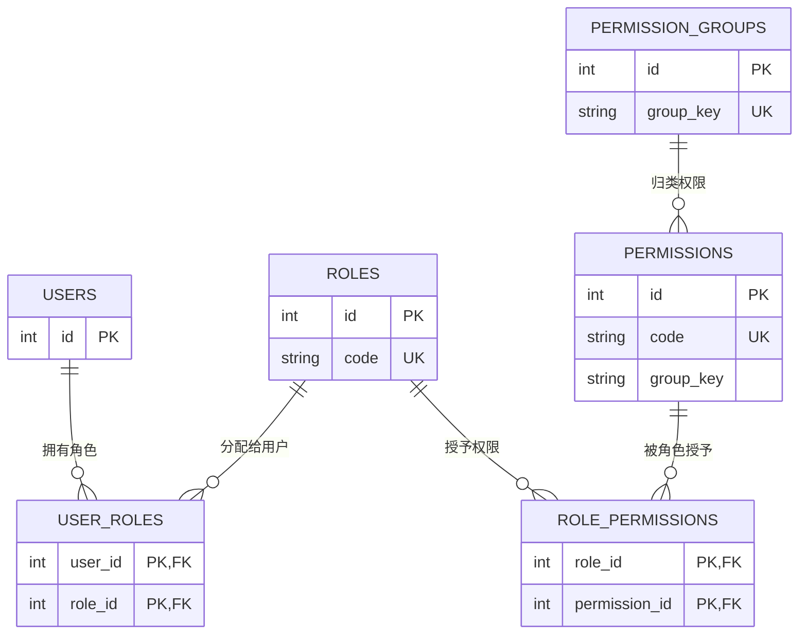

# 1. 需求

## 目标与范围

- 角色是用来管理功能权限的，建立的是“用户—角色—权限”这样的模型
- 系统默认初始化有两个系统角色，分别为超级管理员和普通用户，这两种角色由初始化数据库来完成，
	超级管理员，中文：超级管理员，英文：super_admin
	普通用户，中文：普通用户，英文：User
- 系统角色的要求
	系统角色无法删除，系统角色的属性无法被修改；角色属性包括角色代码、中英文显示名称、系统/超级管理员标记、角色作用范围等；权限集合不属于角色属性；
	每个用户至少有一个有效角色；
	超级管理员天生拥有所有的权限，不需要额外的管理；
	超级管理员可以创建自定义角色；
	超级管理员可以修改任意非超级管理员角色（包括普通用户角色和自定义角色）的权限，
	超级管理员可以删除自定义角色
	任何用户可以查看自己的角色，
		可以查看自己拥有什么权限，缺少什么权限，没有什么权限，但不能修改角色信息、权限；

## 非目标与后续阶段

- 目前不区分角色的作用范围，作用范围就是本系统；
- 数据作用域（`scopeType`、`scopeId`）仅保留系统角色不可修改的约束，实际数据范围授权规则不在本期实现。
- 本期不涉及登录、钉钉账户绑定、用户注册或密码策略，相关需求由账户与认证设计负责；本期不修改前端交互。

## 前端 UI 与交互

- 已经限定了只有超级管理员才能查看用户的角色，那么是不是可以区分超级管理员登入后的页面和其他用户登入后的页面；
- 角色权限目录、权限分组的管理页面


# 2. 技术方案

## 业务规则与实施范围

- 建立“用户—角色—权限”的 RBAC 模型：用户与角色为多对多，角色与权限为多对多；启用用户必须至少拥有一个有效角色，最终权限为其全部有效角色权限的并集。
- 角色初始化，通过migrate数据库版本管理控制
	1. 角色也只保留系统角色，即超级管理员和普通用户角色
	2. 部署初始化两个不可删除的系统角色：`super_admin`（超级管理员）和 `user`（普通用户）。系统角色的 `isSystem=true`；其 `code`、`isSystem`、`isSuperAdmin`、`scopeType`、`scopeId` 均不可修改，这些又是如何保证的。初始化过程由数据库 Migration 完成。
			`super_admin` 的 `isSuperAdmin=true`，后端以该标志直接判定其拥有全部现有及后续新增权限，不通过 `role_permissions` 维护且不可修改其权限。`
			`user` 的 `isSystem=true`、`isSuperAdmin=false`，角色属性不可改；其权限集合可由超级管理员维护。
	3. 初始化角色无法被删除，这个删除是由什么保证的
	4. 初始化 Migration 创建两个系统角色并为普通用户角色配置初始权限；超级管理员无需写入所有 `role_permissions` 记录。
	5. 数据库首次部署后，若不存在启用的超级管理员用户，部署期 Bootstrap 必须指定或创建首位超级管理员并绑定 `super_admin`；不得在 Migration、代码或默认配置中写入固定凭据。历史库迁移时，旧 `admin` 用户绑定 `super_admin`，其余用户绑定 `user`。
- 超级管理员可创建、查询、修改和删除自定义角色，
	超级管理员可创建自定义角色，角色名称由超级管理员设置，并以中文、英文分别维护显示文本，角色id由数据库自增
	超级管理员可以修改任意非超级管理员角色（包括普通用户和自定义角色）的权限；
	删除前必须确认没有用户仍绑定该角色。角
	超级管理员可为已存在用户分配一个或多个角色
	后续超级管理员只能由现有超级管理员向已存在用户分配 `super_admin` 角色产生。
- 任何用户可查询自身的角色与有效权限，和缺少哪些权限。
- 普通账户（自动创建、钉钉首次登录创建或由管理员创建）默认分配普通用户角色；
- 权限目录是随功能发布和数据库 Migration 维护的系统目录。角色管理仅能选择已有权限，不提供权限项的增删改查；前端以树形展示，权限分组模型也由数据库维护。
- 权限控制同时覆盖后端强制授权和前端的可见性、可用性控制；前端只改善体验，后端授权结果是唯一安全边界。无权限的功能不应展示，也不得通过直接调用接口使用。
- 系统始终必须至少存在一名“启用且拥有有效超级管理员角色”的用户。停用、删除用户，或撤销其 `super_admin` 角色将造成该条件不满足时，必须拒绝操作。

## 数据与接口设计

### 数据模型与 Migration

```sql
CREATE TABLE permission_groups (
  id INT AUTO_INCREMENT PRIMARY KEY,
  group_key VARCHAR(64) NOT NULL UNIQUE,
  name_zh VARCHAR(100) NOT NULL,
  name_en VARCHAR(100) NOT NULL,
  i18n_key VARCHAR(150) NOT NULL,
  sort_order INT NOT NULL,
  is_active TINYINT(1) NOT NULL DEFAULT 1,
  created_at DATETIME(3) NOT NULL,
  updated_at DATETIME(3) NOT NULL
);

CREATE TABLE roles (
  id INT AUTO_INCREMENT PRIMARY KEY,
  code VARCHAR(64) NOT NULL,
  name_zh VARCHAR(100) NOT NULL,
  name_en VARCHAR(100) NOT NULL,
  is_system TINYINT(1) NOT NULL DEFAULT 0,
  is_super_admin TINYINT(1) NOT NULL DEFAULT 0,
  scope_type VARCHAR(32) NOT NULL DEFAULT 'platform',
  scope_id INT NOT NULL DEFAULT 0,
  created_at DATETIME(3) NOT NULL,
  updated_at DATETIME(3) NOT NULL,
  CONSTRAINT uk_roles_code UNIQUE (code)
);

CREATE TABLE permissions (
  id INT AUTO_INCREMENT PRIMARY KEY,
  code VARCHAR(100) NOT NULL,
  name_zh VARCHAR(100) NOT NULL,
  name_en VARCHAR(100) NOT NULL,
  description VARCHAR(255) NULL,
  group_key VARCHAR(64) NOT NULL,
  sort_order INT NOT NULL DEFAULT 100,
  created_at DATETIME(3) NOT NULL,
  updated_at DATETIME(3) NOT NULL,
  CONSTRAINT uk_permissions_code UNIQUE (code)
);

CREATE TABLE user_roles (
  user_id INT NOT NULL,
  role_id INT NOT NULL,
  created_at DATETIME(3) NOT NULL,
  PRIMARY KEY (user_id, role_id),
  KEY idx_user_roles_role_id (role_id),
  CONSTRAINT fk_user_roles_user
    FOREIGN KEY (user_id) REFERENCES users(id) ON DELETE CASCADE,
  CONSTRAINT fk_user_roles_role
    FOREIGN KEY (role_id) REFERENCES roles(id) ON DELETE RESTRICT
);

CREATE TABLE role_permissions (
  role_id INT NOT NULL,
  permission_id INT NOT NULL,
  created_at DATETIME(3) NOT NULL,
  PRIMARY KEY (role_id, permission_id),
  CONSTRAINT fk_role_permissions_role
    FOREIGN KEY (role_id) REFERENCES roles(id) ON DELETE CASCADE,
  CONSTRAINT fk_role_permissions_permission
    FOREIGN KEY (permission_id) REFERENCES permissions(id) ON DELETE CASCADE
);

CREATE TABLE rbac_invariant_lock (
  id TINYINT PRIMARY KEY,
  CHECK (id = 1)
) ENGINE=InnoDB;

INSERT INTO rbac_invariant_lock (id) VALUES (1);

INSERT INTO roles
  (code, name_zh, name_en, is_system, is_super_admin, scope_type, scope_id, created_at, updated_at)
VALUES
  ('super_admin', '超级管理员', 'Super Administrator', 1, 1, 'platform', 0, UTC_TIMESTAMP(3), UTC_TIMESTAMP(3)),
  ('user', '普通用户', 'User', 1, 0, 'platform', 0, UTC_TIMESTAMP(3), UTC_TIMESTAMP(3));
```

#### 实体关系

`permission_groups.group_key` 是权限分组的稳定业务代码，例如 `role`、`user`；一条分组记录定义该组的中英文显示名、排序和启用状态。`permissions.group_key` 保存所属分组的同一代码，例如权限 `role:manage` 的 `group_key` 为 `role`，用于把权限目录按组展示。它们共同表达“一条权限分组拥有多条权限”的逻辑关系。



| 关系 | 基数 | 关联字段 | 完整性要求 |
| --- | --- | --- | --- |
| 用户—角色 | 多对多 | `user_roles.user_id` → `users.id`；`user_roles.role_id` → `roles.id` | 联合主键避免重复分配；角色删除受关联用户限制。 |
| 角色—权限 | 多对多 | `role_permissions.role_id` → `roles.id`；`role_permissions.permission_id` → `permissions.id` | 联合主键避免重复授权；角色删除时可级联删除角色权限。 |
| 权限组—权限 | 一对多 | `permissions.group_key` = `permission_groups.group_key` | 权限的分组代码必须对应一个已初始化的权限分组；分组与权限目录均由 Migration 维护。 |

#### 建模说明

- `roles.code` 与 `permissions.code` 是稳定业务代码，分别用于授权识别和权限判断；展示名不参与授权。初始角色、权限组和权限目录均通过 Migration 写入。
- Sequelize 以 `group_key` 关联 `Permission` 与 `PermissionGroup`。当前 Migration 未创建该字段的数据库外键，因此 Migration 必须保证两张目录表一致；若后续允许独立维护权限组，应新增外键或等价数据库约束。

### 后端 Service 契约

控制器只负责请求校验、调用 Service 和映射 HTTP 响应；RBAC 业务规则、事务边界与审计写入集中在以下 Service 中，不允许控制器或 Repository 绕过这些约束直接修改关联表。

#### 跨表业务规则

以下规则不是单一数据表的字段或约束，必须由 Service 在同一事务中锁定并校验受影响的用户、角色及关联记录后执行：

- 每个启用用户至少保留一个有效角色；系统至少保留一名启用且拥有有效超级管理员角色的用户。
- 删除角色前检查 `user_roles` 关联；仍被分配时返回 `ROLE_ASSIGNED_TO_USERS`，不得级联删除用户角色。
- 数据库联合主键仅防止重复关联，不能替代上述业务不变量校验。

| Service                    | 核心职责                                                                            | 事务与审计要求                                                   |
| -------------------------- | ------------------------------------------------------------------------------- | --------------------------------------------------------- |
| `RoleService`              | 查询角色、创建自定义角色、修改角色展示信息、删除未分配的自定义角色，以及更新普通用户/自定义角色的权限。                            | 创建、更新、删除及权限更新在同一事务内完成，并写入对应 RBAC 审计事件。删除前锁定并检查角色关联用户数。    |
| `UserRoleService`          | 查询用户角色，为用户完整替换角色集合；负责普通用户默认角色分配。                                                | 锁定目标用户及受影响的角色关联，校验“至少一个有效角色”和“至少一名有效超级管理员”，成功变更与审计记录原子提交。 |
| `AuthorizationService`     | 计算当前用户的有效角色、是否超级管理员和有效权限；提供 `hasPermission` / `requirePermission` 给授权中间件与业务层使用。 | 只读；角色、用户状态或角色权限提交变更后必须使其缓存（如有）失效。                         |
| `RoleBootstrapService`（可选） | 封装初始角色、初始权限目录和普通用户默认角色的幂等写入逻辑。                                                  | 由数据库 Migration 调用或承载其等价逻辑；不得提供普通 HTTP 管理入口。               |

### Service 方法与参数

下列为跨模块可调用的公开 Service 契约。Service 接收的是已完成协议层校验后的普通对象；`auditContext` 仅包含审计所需的操作者和请求关联信息，不得传入或依赖 HTTP `req`、`res`。

| Service 方法                                                        | 输入                                          | 返回                  | 业务错误                                                                                                          | 说明                         |
| ----------------------------------------------------------------- | ------------------------------------------- | ------------------- | ------------------------------------------------------------------------------------------------------------- | -------------------------- |
| `RoleService.list(query)`                                         | `RoleListQuery`                             | `RolePage`          | 无                                                                                                             | 角色分页列表，按 `createdAt DESC`。 |
| `RoleService.get(roleId)`                                         | `roleId`                                    | `RoleView`          | `ROLE_NOT_FOUND`                                                                                              | 查询角色及其权限码。                 |
| `RoleService.create(command, auditContext)`                       | `CreateRoleCommand`、`AuditContext`          | `RoleView`          | `INVALID_ROLE_CODE`、`ROLE_CODE_EXISTS`、`INVALID_PERMISSION_CODE`                                              | 创建非系统、非超级管理员的自定义角色并设置权限。   |
| `RoleService.update(roleId, command, auditContext)`               | `roleId`、`UpdateRoleCommand`、`AuditContext` | `RoleView`          | `ROLE_NOT_FOUND`、`SYSTEM_ROLE_FIELDS_IMMUTABLE`、`SUPER_ADMIN_PERMISSIONS_IMMUTABLE`、`INVALID_PERMISSION_CODE` | 仅更新允许修改的展示名与权限集合。          |
| `RoleService.delete(roleId, auditContext)`                        | `roleId`、`AuditContext`                     | 无                   | `ROLE_NOT_FOUND`、`SYSTEM_ROLE_DELETE_FORBIDDEN`、`ROLE_ASSIGNED_TO_USERS`                                      | 仅删除未分配的自定义角色。              |
| `UserRoleService.replaceUserRoles(userId, roleIds, auditContext)` | `userId`、`roleIds`、`AuditContext`           | `string[]`（角色代码）    | `USER_NOT_FOUND`、`USER_REQUIRES_ROLE`、`INVALID_ROLE_ASSIGNMENT`、`LAST_SUPER_ADMIN_REQUIRED`                   | 以完整集合替换用户角色。               |
| `UserRoleService.assignDefaultRole(userId, options)`              | `userId`、可选事务 `options.transaction`         | 无                   | 默认 `user` 角色不存在时失败                                                                                            | 仅供用户创建、钉钉绑定等内部流程调用。        |
| `AuthorizationService.getAuthorization(userId)`                   | `userId`                                    | `AuthorizationView` | `USER_NOT_FOUND`（如调用方要求严格存在性校验）                                                                               | 返回有效角色、超级管理员标记和去重后的有效权限。   |

#### 角色 Service 输入与输出

| 类型                  | 字段                                                                                              | 类型               | 必填       | 约束与语义                                                             |
| ------------------- | ----------------------------------------------------------------------------------------------- | ---------------- | -------- | ----------------------------------------------------------------- |
| `CreateRoleCommand` | `code`                                                                                          | string           | 是        | 角色稳定代码；匹配 `^[a-z][a-z0-9_:-]{1,63}$`；全局唯一。                        |
| `CreateRoleCommand` | `nameZh`                                                                                        | string           | 是        | 中文显示名；去除首尾空白后长度为 1–100。                                           |
| `CreateRoleCommand` | `nameEn`                                                                                        | string           | 是        | 英文显示名；去除首尾空白后长度为 1–100。                                           |
| `CreateRoleCommand` | `permissionCodes`                                                                               | string[]         | 是        | 权限码集合；可为空数组；每一项必须存在于权限目录，重复项按单一权限处理。                              |
| `UpdateRoleCommand` | `nameZh`                                                                                        | string           | 否        | 与创建时相同；仅非系统角色可修改。                                                 |
| `UpdateRoleCommand` | `nameEn`                                                                                        | string           | 否        | 与创建时相同；仅非系统角色可修改。                                                 |
| `UpdateRoleCommand` | `permissionCodes`                                                                               | string[]         | 否        | 出现即表示完整替换；超级管理员角色不可修改；普通用户角色与自定义角色可修改。                            |
| `RoleListQuery`     | `page`                                                                                          | positive integer | 否        | 默认 `1`。                                                           |
| `RoleListQuery`     | `limit`                                                                                         | positive integer | 否        | 默认 `20`，最大 `100`。                                                 |
| `RolePage`          | `items`、`total`、`page`、`limit`                                                                  | object           | 是        | 符合统一分页响应；`items` 的元素为 `RoleView`。                                 |
| `AuditContext`      | `actor`、`requestId`、`ip`、`userAgent`                                                            | object           | 是（高风险变更） | 由 API/任务入口构造，供 `AuditService` 补充审计公共字段；不得由客户端任意指定。                |
| `RoleView`          | `id`、`code`、`nameZh`、`nameEn`、`isSystem`、`isSuperAdmin`、`scopeType`、`scopeId`、`permissionCodes` | object           | 是        | 对外角色视图；字段使用 camelCase，`permissionCodes` 为去重排序后的权限码。               |
| `AuthorizationView` | `roles`、`isSuperAdmin`、`permissions`                                                            | object           | 是        | `roles` 与 `permissions` 均为稳定代码数组；超级管理员的 `permissions` 必须表达其全权限语义。 |

- `roleId` 和 `userId` 均为正整数。Service 层即使由 API 层完成过校验，也必须在涉及数据完整性或权限不变量的路径再次校验。
- `CreateRoleCommand`、`UpdateRoleCommand` 不包含 `isSystem`、`isSuperAdmin`、`scopeType`、`scopeId`；这些字段既不是可写 API 参数，也不是可写 Service 参数。
- 角色创建、角色更新、权限替换、删除、用户角色替换必须在单一事务中完成全部业务校验、数据变更和成功审计写入。最后一名有效超级管理员保护被拒绝时，按事件定义记录独立的拒绝审计事实。
- `RoleService.create(command, auditContext)`、`RoleService.update(roleId, command, auditContext)`、`RoleService.delete(roleId, auditContext)` 是内部 Service 契约，不直接暴露为 HTTP API；角色权限的完整替换由 `update` 的 `permissionCodes` 字段承载。
- `UserRoleService.replaceUserRoles(userId, roleIds, auditContext)` 以完整角色集合替换现有分配；自动创建用户的默认普通用户分配使用 `UserRoleService.assignDefaultRole(userId, { transaction })`，避免在账户流程中直接写 `user_roles`。
- `AuthorizationService.getAuthorization(userId)` 返回角色代码、`isSuperAdmin` 和去重后的权限码；授权中间件以它为唯一授权数据来源。
- Service 接收请求上下文中的事务与审计上下文；高风险成功操作必须在同一事务中调用 `AuditService.record(...)`。Repository 仅负责数据访问、行锁和持久化，不承担权限判断或审计事件定义。

### 授权决策

```text
请求
  ├─ 无 Bearer Token、Token 无效或过期                         → 401 UNAUTHORIZED
  ├─ Token → userId → 用户不存在或 is_active = false            → 403 FORBIDDEN
  └─ 有效启用用户
       ├─ 任一有效角色 is_super_admin = true                    → ALLOW
       ├─ 所有角色的 permissionCodes 去重并集包含 requiredCode → ALLOW
       └─ 其他情况                                               → 403 FORBIDDEN
```

- `requiredCode` 由后端路由声明；前端菜单和按钮只能读取授权结果，不能作出安全决策。
- 每次请求从数据库重新计算授权结果；角色、角色权限、用户角色或用户状态变更后，下一次请求立即生效。

### HTTP API 契约

接口使用 `/api` 前缀、Bearer Token 鉴权，并在 OpenAPI 以 `security` 和 `x-required-permission` 声明权限。建议资源与权限边界如下：

| 接口                              | 所需权限               | 用途                                 |
| ------------------------------- | ------------------ | ---------------------------------- |
| `GET /api/me/authorization`     | 已认证                | 返回当前用户的角色、是否超级管理员及有效权限。            |
| `GET /api/roles`                | `role:read`        | 分页查询角色，默认按创建时间倒序。                  |
| `POST /api/roles`               | `role:manage`      | 创建自定义角色，并一次性设置权限。                  |
| `GET /api/roles/{roleId}`       | `role:read`        | 查询角色详情及已授予权限。                      |
| `PATCH /api/roles/{roleId}`     | `role:manage`      | 修改自定义角色展示信息和普通用户/自定义角色权限；受保护字段不可变。 |
| `DELETE /api/roles/{roleId}`    | `role:manage`      | 删除未被分配的自定义角色。                      |
| `PUT /api/users/{userId}/roles` | `user:role:assign` | 以完整目标角色集合重新分配用户角色。                 |
| `GET /api/permissions`          | `role:read`        | 返回只读系统权限目录，供角色编辑器使用。               |

- `POST /api/roles` 的请求包含 `code`、`nameZh`、`nameEn`、`permissionCodes`；`code` 已存在时返回 `409 ROLE_CODE_EXISTS`。创建系统角色的请求必须被拒绝。
- `PATCH /api/roles/{roleId}` 可选 `nameZh`、`nameEn`、`permissionCodes`；对超级管理员角色的权限修改返回 `422 SUPER_ADMIN_PERMISSIONS_IMMUTABLE`；试图改动任一系统角色受保护属性返回 `422 SYSTEM_ROLE_FIELDS_IMMUTABLE`。
- `DELETE /api/roles/{roleId}` 对系统角色返回 `422 SYSTEM_ROLE_DELETE_FORBIDDEN`；存在用户关联时返回 `409 ROLE_ASSIGNED_TO_USERS`。
- `PUT /api/users/{userId}/roles` 的 `roleIds` 是完整替换集合，不能为空；目标中不存在、已删除或不可分配的角色时返回 `422 INVALID_ROLE_ASSIGNMENT`。导致目标用户没有有效角色时返回 `422 USER_REQUIRES_ROLE`；导致系统失去最后一名有效超级管理员时返回 `422 LAST_SUPER_ADMIN_REQUIRED`。
- 用户停用、删除等其他模块中的操作也必须复用同一“最后一名有效超级管理员”校验，并返回一致的 `LAST_SUPER_ADMIN_REQUIRED` 错误码。
- 所有新增接口必须在 `backend/openapi/openapi.yaml` 及相应 `paths`、`schemas` 文件中定义请求、响应、权限与错误响应；响应不得暴露内部敏感数据。

### HTTP API 参数与响应

API 是 Service 的外部协议映射：Controller 解析 path/query/body、完成鉴权和格式校验后组装 Service 输入；不得将 HTTP 请求对象传入 Service。除 `DELETE` 外，成功响应均返回 JSON；错误响应遵循 `{ code, message, requestId }`。

| 接口 | Path / Query 参数 | 请求体 | 成功响应 |
| --- | --- | --- | --- |
| `GET /api/me/authorization` | 无 | 无 | `AuthorizationView`。 |
| `GET /api/roles` | `page`、`limit`，与 `RoleListQuery` 相同 | 无 | `{ items: RoleView[], total, page, limit }`。 |
| `POST /api/roles` | 无 | `CreateRoleCommand` | `201 { role: RoleView }`。 |
| `GET /api/roles/{roleId}` | `roleId`：正整数 | 无 | `{ role: RoleView }`。 |
| `PATCH /api/roles/{roleId}` | `roleId`：正整数 | `UpdateRoleCommand`；至少提供一个可写字段 | `{ role: RoleView }`。 |
| `DELETE /api/roles/{roleId}` | `roleId`：正整数 | 无 | `204 No Content`。 |
| `PUT /api/users/{userId}/roles` | `userId`：正整数 | `{ roleIds: positive integer[] }`；至少一项；作为完整替换集合 | `{ userId, roleCodes }`。 |
| `GET /api/permissions` | 无 | 无 | 权限目录及分组的只读视图。 |

- API 请求体使用 camelCase；Controller 显式映射为 Service Command。数据库字段（如 `name_zh`、`is_system`）不得出现在请求体中。
- OpenAPI 必须逐字段定义类型、必填性、长度/正则、数组最小项数和枚举；列表响应、`RoleView`、`AuthorizationView` 与错误响应也必须有 schema，不能只写响应描述。
- `PATCH` 的缺失字段表示“不变”；`permissionCodes: []` 表示清空该角色的全部显式权限，二者不可混淆。

## 权限与安全

### 本功能涉及的权限

```text
# 角色与权限目录
role:read          # 查询角色、角色详情、权限目录
role:manage        # 创建、修改、删除自定义角色；修改普通用户角色权限

# 用户角色分配
user:role:assign   # 完整替换指定用户的角色集合

# 用户生命周期（影响“至少一名有效超级管理员”不变量）
user:read          # 查询用户及指定用户的角色
user:create        # 创建用户；服务端自动分配 user 角色
user:update        # 修改或停用用户
user:delete        # 删除用户

# 审计记录查询
audit:read         # 查询 RBAC 审计记录
audit:export       # 导出 RBAC 审计记录
```

- 只有超级管理员具备 `role:manage` 和 `user:role:assign`；权限初始化须确保超级管理员始终通过 `is_super_admin` 获得这两项能力。普通用户或自定义角色可获得 `role:read`，但不得借此修改角色或分配角色。
- 服务端不接受客户端传入的 `isSystem`、`isSuperAdmin`、`scopeType`、`scopeId` 作为可写业务字段；系统角色创建、系统标记变更和超级管理员标记变更均由受控初始化或既定分配流程处理。
- 分配超级管理员角色、撤销超级管理员角色、停用/删除超级管理员用户和删除角色属于高风险操作，必须在一个事务内完成业务校验、状态变更及成功审计记录写入。
- 角色代码、权限代码和数据库主键均由服务端严格校验；不以角色名称、前端传入的权限摘要或客户端缓存作为授权依据。
- 自定义角色被删除前始终检查关联关系；不允许通过批量更新、管理员接口或并发请求绕过用户最少角色和最后超级管理员约束。

## 审计与运行日志

- 本文档通过下表维护必须审计的业务动作、事件码、触发时机和审计目标。事件码采用稳定的 `RBAC.*` 命名；“重新分配”包含首次分配和后续角色集合变更。

| 业务动作            | 事件码                                | 何时记录                 | 审计目标  |
| --------------- | ---------------------------------- | -------------------- | ----- |
| 创建自定义角色         | `RBAC.ROLE_CREATED`                | 创建成功                 | 角色    |
| 修改角色展示信息        | `RBAC.ROLE_UPDATED`                | 修改成功                 | 角色    |
| 删除自定义角色         | `RBAC.ROLE_DELETED`                | 删除成功                 | 角色    |
| 修改普通用户或自定义角色的权限 | `RBAC.ROLE_PERMISSIONS_UPDATED`    | 权限变更成功               | 角色    |
| 分配或重新分配用户角色     | `RBAC.USER_ROLE_REASSIGNED`        | 角色集合变更成功             | 用户    |
| 分配或重新分配超级管理员角色  | `RBAC.SUPER_ADMIN_ROLE_REASSIGNED` | 角色集合变更成功             | 用户    |
| 保护最后一名有效超级管理员   | `RBAC.LAST_SUPER_ADMIN_PROTECTED`  | 撤销、停用或删除操作被拒绝        | 用户    |

- `RBAC.ROLE_CREATED`、`RBAC.ROLE_UPDATED` 和 `RBAC.ROLE_DELETED` 的 `details` 为 `roleCode`；角色权限和用户角色变更使用事件定义允许的 `before`、`after` 结构；最后一名超级管理员保护使用 `context.attemptedAction` 与 `context.remainingActiveSuperAdminCount`。不得自行扩展 `details` 字段。
- `AuditService` 统一补充操作者、时间、IP 与请求标识，并按全局规则脱敏。不得记录密码、Token、验证码或钉钉授权信息。
- 成功的角色、角色权限和用户角色变更与审计记录在同一数据库事务中提交；最后一名有效超级管理员保护被拒绝时，以 `DENIED` 和 `RBAC.LAST_SUPER_ADMIN_PROTECTED` 原因码记录审计。
- 当前 RBAC 事件定义仅要求对“最后一名有效超级管理员”保护写入 `DENIED` 审计；其他授权或参数拒绝使用安全的业务错误码和可检索运行日志响应，除非先在 `eventDefinitions.js` 新增对应审计事件。日志不得泄露令牌、完整权限快照等敏感内容。

# 3. 验收标准与测试

- Migration 能在空测试数据库创建 RBAC 表、约束、初始角色和权限目录；重复执行不会产生重复的系统角色或关联。
- 单元测试覆盖：多角色权限取并集、超级管理员绕过角色权限表获得任意权限、已删除角色不参与授权、普通用户角色权限可更新、超级管理员角色权限不可更新。
- 单元测试覆盖角色创建、唯一角色代码校验、系统角色受保护字段校验、删除已分配角色拒绝，以及权限码/角色 ID 的输入校验。
- 集成测试覆盖：超级管理员创建自定义角色并同时配置权限；用户拥有多个角色后的接口授权；无权限用户访问受保护 API 返回 `403`，且前端权限数据不包含对应功能。
- 集成测试覆盖用户角色完整替换、空角色集合拒绝、最后一名有效超级管理员的角色撤销/停用/删除均被拒绝，以及并发或相邻请求下该不变量仍成立。
- 集成测试验证普通账户创建与钉钉首次登录创建路径默认分配普通用户角色；只有既有超级管理员向已存在用户分配后才产生新的超级管理员。
- 接口测试验证每个新增/变更 API 的状态码、错误码、响应结构、分页与权限声明均符合 OpenAPI；OpenAPI、实现及测试在同一变更中更新。
- 审计集成测试验证成功变更与审计记录原子提交，拒绝操作写入带原因码的审计记录，且审计包含前后值、操作者、目标和请求关联信息而不包含敏感凭据。


