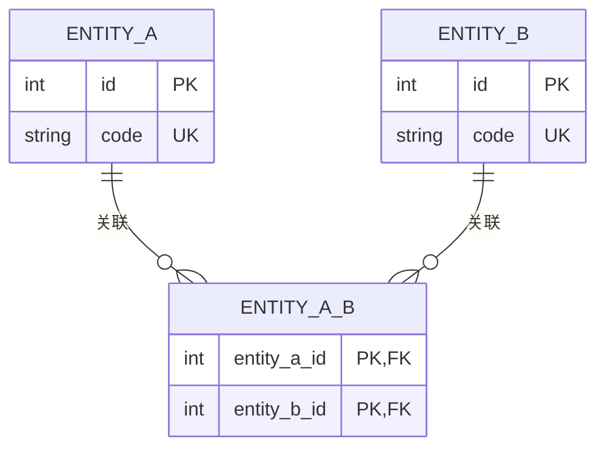

# 1. 需求
## 目标与范围

用于描述功能需求，从实际的使用角度出发
## 非目标与后续阶段

定义本次不做实现的内容，但并不代表永远不执行
## 前端 UI 与交互

描述前端设计，未来会增加figma连接
# 2. 技术方案
## 数据与接口设计

根据需求来设计技术方案，需要可执行；
### 数据模型与 Migration

本节只描述数据事实：实体、关联、字段、数据库约束、索引和由 Migration 写入的初始数据。跨表业务不变量、事务与操作步骤应写在“后端 Service 契约”。

#### 实体关系



| 关系 | 基数 | 关联字段 | 完整性要求 |
| --- | --- | --- | --- |
| 待补充 | 待补充 | 待补充 | 主键、外键、唯一约束、删除行为等。 |

#### Migration / SQL

以下 SQL 仅为结构示例，须替换为本功能的 Migration 设计。所有表、字段、约束、索引和初始目录数据必须由 Migration 创建或演进。

```SQL
CREATE TABLE example_entities (
  id INT AUTO_INCREMENT PRIMARY KEY,
  code VARCHAR(64) NOT NULL,
  name VARCHAR(100) NOT NULL,
  created_at DATETIME(3) NOT NULL,
  updated_at DATETIME(3) NOT NULL,
  CONSTRAINT uk_example_entities_code UNIQUE (code)
);
```

#### 建模说明

- 待补充：稳定业务标识与展示字段的区分，以及关系表存在的原因。
- 待补充：不能由数据库外键或约束直接保证的关系完整性；说明由哪个 Migration 或 Service 负责保证。

### 后端 Service 契约

定义后端 Servcice的核心职责

| Service | 核心职责 | 事务与审计要求 |
| ------- | ---- | ------- |
|         |      |         |

#### 跨表业务规则

仅记录无法由单一表字段、外键或唯一约束完整表达的规则。必须说明由哪个 Service 在何种事务和锁范围内校验。

| 业务不变量/规则 | 负责 Service | 事务与并发控制 | 不满足时的结果 |
| --- | --- | --- | --- |
| 待补充 | 待补充 | 待补充 | 待补充 |

| 参数     | 位置      | 类型     | 必填  | 取值/格式                                       | 默认值 | 说明                |
| ------ | ------- | ------ | --- | ------------------------------------------- | --- | ----------------- |
| `role` | 请求体/响应体 | string | 是   | `user` \| `assistant` \| `system` \| `tool` | 无   | 消息来源角色；仅可使用枚举中的值。 |

`role` 的语义如下：

| 值 | 含义 | 典型用途 |
| --- | --- | --- |
| `user` | 最终用户发出的消息 | 用户输入、附件上传 |
| `assistant` | Agent/LLM 生成的消息 | 编排结果、面向用户的回复 |
| `system` | 系统产生的消息 | 系统提示、内部异常 |
| `tool` | 工具调用返回的消息 | 工具执行结果 |

接口字段使用 camelCase；落库字段使用 snake_case。若 `role` 需要持久化，数据库字段应为 `role`，并通过 Migration 创建 `CHECK` 约束（或等价枚举约束）以限制上述四个值。
### 授权决策

用于说明后端如何判定调用方是否可以进入某项业务操作。授权决策只回答“是否有资格调用”；进入业务 Service 后的状态约束、数据完整性校验等属于业务规则，应另行列明。

```text
请求
  ├─ 未携带凭据、凭据无效或过期                    → 401 UNAUTHORIZED
  ├─ 凭据对应用户不存在、已停用或不满足访问条件       → 403 FORBIDDEN
  └─ 有效调用方
       ├─ 满足超级管理员/系统调用方等特权条件         → ALLOW
       ├─ 有效权限集合包含接口所需权限码             → ALLOW
       └─ 其他情况                                  → 403 FORBIDDEN
```

| 受保护操作/接口 | 所需权限或特权条件 | 授权数据来源 | 授权成功后的业务规则 |
| --- | --- | --- | --- |
| 待补充 | 待补充 | 后端计算的有效身份、角色和权限 | 待补充 |

- 所需权限码由 API 路由声明，并在 OpenAPI 的 `security`、`x-required-permission` 中同步定义；前端仅据此控制可见性与可用性，不能作为安全边界。
- Service 对会影响数据权限、不变量或高风险状态的操作，必须再次执行必要的业务层授权校验。
- 举例：调用方拥有删除权限，只代表可进入删除流程；目标为系统对象、仍被关联或将破坏系统不变量时，应由业务规则返回相应的 `422` 或 `409`，而不是错误地返回权限不足。

### HTTP API 契约

| 接口                              | 所需权限               | 用途                                 |
| ------------------------------- | ------------------ | ---------------------------------- |
| `GET /api/me/authorization`     | 已认证                | 返回当前用户的角色、是否超级管理员及有效权限。            |
## 权限与安全

### 涉及权限

```text
# type
function:action          # 说明
```

### 安全约束

- 待补充：数据范围、鉴权边界、脱敏与输入校验等本功能特有约束。

## 审计与运行日志

| 业务动作 | 事件码 | 何时记录 | 审计目标 |
| ---- | --- | ---- | ---- |
| 待补充 | 待补充 | 待补充 | 待补充 |

审计统一通过 `AuditService` 写入；事件码、允许的结果与原因码、`details` 白名单以 `backend/src/audit/eventDefinitions.js` 为唯一来源。

# 3. 验收标准与测试


