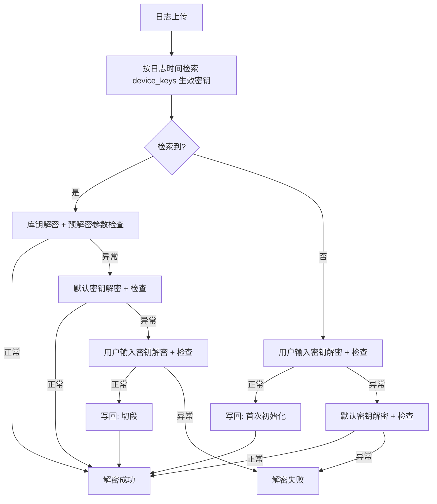

# 详细需求

## 一、项目概述

logTool 是一个集成故障码管理、日志上传与解析、账户与权限管理于一体的系统，面向具备不同权限的用户，提供一套完整的设备日志与故障码管理平台，支持多语言翻译及 XML 数据导出功能。

## 二、主要功能模块

## 0. dashboard层级划分：

按照以下的层级划分调整dashboard，增加日志分析等级管理页面，支持增删改查

- 故障码管理
    - 故障码：故障码筛选器、故障码导出、故障码查询、故障码增删改查；
    - 多语言：多语言导入（单条、批量导入）、导出xml文件、多语言筛选器
    - 故障案列查询
    - 知识库
    - ~~日志分析等级~~，数据配置：日志分析等级的增删改查、故障案例状态增删改查、模块增删改查、知识库文件类型
- 日志与手术分析
    - 日志管理：日志上传、日志（批量）查看、日志（批量）重新解析、日志（批量）删除、日志筛选器
    - 数据解析：数据解析、数据下载
    - 手术数据管理（暂无内容）：手术数据查看、手术数据可视化、手术数据删除
- 全局看板：查看现有的用户数量、故障码数量、日志条目数量；
- 缺陷反馈：反馈现有缺陷
- 账户信息：个人的账户信息（邮箱和密码的修改）
- 系统管理
    - 用户管理：用户的增删改查
    - 角色管理：角色的增删改查、权限设置；
    - 设备管理：现有设备的增删改查；
    - 历史记录：用户操作日志查看
    - 系统监控：系统进程、系统内存、队列任务数查看；
- 测试
    - 释义测试；
    - 可视化测试；
    - /

## 1. 故障码管理模块

### 1.1 功能需求

完整的故障码为16进制的无符号长整形，由子系统ID、故障臂号、故障关节号、故障码、故障等级组成；

- 展示部分故障码数据库中的内容，表头：子系统号 | 故障码 | 给用户的提示信息+操作信息|参数1|参数2|参数3|参数4|检测方法|
- 显示的内容根据系统语言显示对应多语言表（i18n_error_codes）内的内容
- 按照权限区分支持不同用户类型对于故障码数据库的增删改查操作；
- 故障码的增加修改对于各字段的需求如下
    
    
    | 列名 | 填写方式 | 有效值 | 字段 | 必填 |
    | --- | --- | --- | --- | --- |
    | 子系统 | 01：运动控制软件；02：人机交互软件；03：医生控制台软件；04：手术台车软件；05：驱动器软件；06：图像软件；07：工具工厂软件。08：远程运动控制软件09：远程医生控制台软件0A: 远程驱动器软件；
    仅可以填写上述子系统编号之一 | 1、2、3、4、5、6、7、8、9、A | subsystem  | Y |
    | 故障码 | 区分故障类型不能重复，以“0X010A”形式填写，最后一位必须为字母且仅为“A、B、C、D、E”中一个A:A类故障报警，报警等级最高，影响状态机跳转；B:B类故障报警，报警等级次高，影响状态机跳转；C:C类故障报警，不影响状态机跳转，可忽略；D:提示信息；E:日志记录； | 以“0X010A”形式填写;
    其中0X为16进制标志符，
    最后一位必须为字母且仅为“A、B、C、D、E”中一个；
    由子系统号与故障码组成的故障码不会重复对应唯一的故障类型 | code  | Y |
    | 是否轴错误（TRUE/FALSE） | 标识此故障是否会有关节号，不影响交互软件显示；true = 有关节号，false = 无关节号 | TRUE/FALSE | is_arm_error | Y |
    | 精简提示信息 | 普通账户下人机交互软件显示的中文提示信息，中文文字填写；1.任意一个非日志记录的故障码必须有精简的提示信息或操作信息其中之一；2.提示类故障，精简提示信息与给用户的提示信息一致； | 中文文字填写 | short_message | Y |
    | 精简提示信息英文 | 普通账户下人机交互软件显示的英文提示信息，英文文字填写； | 英文文字填写 | short_message_en  | Y |
    | 给用户的提示信息 | 维护账户或管理员账户下人机交互软件显示的中文提示信息，中文文字填写； | 中文文字填写 | user_hint  | Y |
    | 给用户的提示信息英文 | 维护账户或管理员账户下人机交互软件显示的英文提示信息，英文文字填写； | 英文文字填写 | user_hint_en  | Y |
    | 操作信息 | 人机交互软件显示的中文操作信息，中文文字填写； | 中文文字填写 | operation  | Y |
    | 操作信息英文 | 人机交互软件显示的英文操作信息，英文文字填写； | 英文文字填写 | operation_en  | Y |
    | 是否臂错误
    （TRUE/FALSE） | 决定人机交互软件是否显示“XX臂”；TRUE = 显示“XX臂”，FALSE = 不显示“XX臂”， | TRUE/FALSE | is_axis_error  | Y |
    | 详细信息 | 故障详细信息与描述 | 中文文字填写 | detail  | Y |
    | 检测方法 | 故障检测方法的简述 | 中文文字填写 | method  | Y |
    | 参数1 | 故障日志记录的参数1 | 中文文字填写 | param1  | Y |
    | 参数2 | 故障日志记录的参数2 | 中文文字填写 | param2 | Y |
    | 参数3 | 故障日志记录的参数3 | 中文文字填写 | param3 | Y |
    | 参数4 | 故障日志记录的参数4 | 中文文字填写 | param4 | Y |
    | 处理措施 | 故障的处理，根据故障码确定
    方式A类故障：recoverable可恢复故障；recoverable可恢复故障；C类故障ignorable可忽略故障；D类tip提示信息,；E类log日志记录；仅在error_codes表，切换不同语言通过 | recoverable
    unrecoverable
    tips
    log
    ignorable | solution  | N |
    | 专家模式
    （TRUE/FALSE） | 用于区分是否在专家模式下显示记录该操作提示 | TRUE/FALSE | for_expert  | N |
    | 初学者模式
    （TRUE/FALSE） | 用于区分是否在初学者模式下显示记录该操作提示 | TRUE/FALSE | for_novice  | N |
    | 日志
    （TRUE/FALSE） | 用于区是否需要在UI日志中被记录 | TRUE/FALSE | related_log | N |
    | 停止上报方法 |  | text | stop_report | N |
    | 日志分析等级 | 个每个故障码设定分类一对多的形式 |  | VARCHAR |  |
    | 故障等级 | 故障等级说明、根据故障码确定
    高级：A类故障；
    中级：B类故障；
    低级：C类故障；
    无：提示信息或日志记录； | 高级
    中级
    低级
    无 | level  | N |
    | 技术排查方案 | 故障报警的排查方案，用于故障小程序中 | 中文文字填写 | tech_solution  | N |
    | 解释 | 故障报警的解释，用于日志分析工具解析；
    需要结合故障详细信息，解释故障具体含义与各参数的含义 | 中文文字填写 | explanation  | N |
    | 故障分类 | 故障报警的分类，用于故障小程序中 | 软件
    硬件
    日志记录
    操作提示
    安全保护 | category  | Y |
- 新增或修改故障码时，在弹窗标题的左侧加语言切换（tab/下拉菜单选择语言），并添加「自动翻译」按钮
    - 新增或修改故障码，根据用户选择的系统语言默认显示对应的语言；
    - 下拉选择语言后 ，弹窗中拥有多语言字段故障码表的数据会切换为对应的多语言表里的内容，若空不需要返回故障码表中的内容
    - 精简提示信息、给用户的提示信息、操作信息也需要参与自动翻译
    - 自动翻译是从中文自动翻译到对应语言，调用第三方翻译 API（讯飞），api调取失败后“提示自动翻译失败”
    - 保存时写入 i18n_error_codes(lang=目标语言) 中对应字段
    - 不需要单独分割的技术说明字段多语言编辑板块，根据用户选择的系统语言默认显示对应的语言的字段，显示的内容就是故障码表的字段（故障码表中有多语言的字段需要匹配对应多语言表中的字段）
    - **自动翻译逻辑**：只翻译多语言中空白的部分（修改或者新增弹窗中空白部分才会被自动翻译，减少api调用，避免用户手动填写的被覆盖），保护人工修改，要求用户显式确认；
    - Category、level、Solution的数据源都是根据error_codes获得的，不需要参与翻译，不同系统语言下使用i8n翻译
- 添加和修改故障码时，支持同步添加或修改本地和远程端对应的故障码，子系统定义中：其中 01和08，03和09，05和0A 对应的子系统一致，仅区分了本地和远程端，因此在修改或添加时选择了子系统为01和08，03和09，05和0A的故障码的弹窗内增加:同步选项：同步更新到本地/远程端；特别的，若修改时故障码不存在时，自动创建；
- 故障码管理页面支持模糊搜索功能；
- 故障码管理页面增加故障码查询功能：
    - 在“添加故障码”按钮左侧，增加“故障码查询”按钮，点击后出现故障码查询的弹窗，用户输入完整的故障码（例如141010A），点击查询，显示该故障码的  |给用户的提示信息 +操作信息|参数1-4的具体含义|详细信息|检查方法|技术排查方案|故障分类|；可以借鉴释义测试功能 ^7f5bf9
    - 显示的内容根据系统语言显示对应多语言表（i18n_error_codes）内的内容
- 技术排查方案：目前只支持文字，独立的修改页面，独立的查看页面
    - 开发时是存在本地，部署后存在oss，此项可配置；
    - 下载过程从oss获取后从云服务中下载，oss和云服务器相当于内网
    - 故障码管理页面的操作列增加，排查方案修改按钮，与设备详细日志列表中操作列一样，默认显示在省略号中，将删除按钮也放入省略号中；
    - 点击“排查方案修改”后展示一个全高抽屉，显示排查方案修改页面，支持填写文本，增加支持附件上传，附件仅支持图片，每个技术排查方案最多5张图片
    - 图片支持在线查看
- 查询时需要可以显示技术排查方案的附件，图片支持预览，其他类型的附件 提供下载按钮，
- 多语言管理页面
    - 支持导出当前故障码数据库中的内容至 XML 格式；
    - 其中故障码数据表（通过子系统号+故障码 对应到多语言数据表）的精简提示信息（short_message） 、给用户的提示信息（user_hint） 、操作信息（operation） 三列支持多语言模式，并且具备可扩展性；
    - 具备导出xml、导入对应语言的精简提示信息（short_message） 、给用户的提示信息（user_hint） 、操作信息（operation） 和搜索三个功能
        - 导入功能：支持多语言的精简提示信息（short_message） 、给用户的提示信息（user_hint） 、操作信息（operation）三个字段的导入（多语言数据表），导入方式支持单行导入数据格式为subsystem,code,short_message,user_hint,operation或批量导入（带表头subsystem,code,short_message,user_hint,operation的csv文件），必须满足： 精简提示信息与操作信息不都为空，给用户的提示信息与操作信息都不为空；
        - 搜索功能：输入 子系统号，故障码 可以显示对应语言的精简提示信息（short_message） 、给用户的提示信息（user_hint） 、操作信息（operation）三个字段的内容；显示列表表头：子系统号 | 故障码 | 精简的提示信息 | 提示信息 | 操作信息
        - 导出xml：支持导出针对不同语言的xml，选择不同的语言可以导出精简提示信息（short_message） 、给用户的提示信息（user_hint） 、操作信息（operation）这三个字段使用不同语言的xml，支持以多选的方式，同时导出多国语言的xml，文件名：FaultAnalysis_XXXXXX.xml，导出的xml格式后续补充；
- 用户对于故障码的增删改查、xml导入和导出记录在系统日志中
- 支持故障码导出成csv格式 包含故障码数据表的所有字段，前端可选择对应的语言后导出对应语言的csv或tsv，其中tsc包含释义部分

### 1.2 配置页面：日志分析等级、故障案例状态、模块

- 日志分析等级，目前设置了这些分类，后续会拓展（Devices,I/O Signals,Image,Safety Checks,Energy,UI Interactive Buttons,CPU,Power Supply,Maintenance Information,Assist Mode,State Machine,Network,Account Management,Self-Test,Driver,Initialization,Ethercat ,Communication Errors,Patient Cart,Hardware,pos record,Boundary,Codecs,Tips,null）任意一个故障码可以拥有多个分类，此分类会用于后续日志批量查看页面的筛选，配置页面可以增删改查
- 故障案例状态：Resolved（已解决）、Unresolved（未解决）、Under observation（观察中）、requirement（需求），配置页面可以增删改查、设置每个状态的映射字段，1对多
- 模块：Patient Platform(患者平台)、Surgeon Console(医生控制台)、Vision Platform(图像平台)、instrument arm（工具臂）、adjustment arm（调整臂）、master arm（主控制臂）、instrument（器械）、motion control software（运动控制软件）、visual software（视觉软件）、Telecommunication Platform（远程通信平台），配置页面可以增删改查、设置每个状态的映射字段，1对多
- 知识库文件类型：问题排查、定义说明、
- 这些配置的表单，知识库文件类型、日志分析列表表头：ID|XX标识|名称|排序顺序|是否启用|操作，模式和故障案例状态列表表头：ID|XX标识|名称|映射|排序顺序|是否启用|操作
    - 操作列：编辑、删除；
    - 故障案例状态、模块：编辑中需要包含修改功能和添加映射的功能

日志分析等级页面改为 配置管理页面，可以对 日志分析等级、故障案例状态、模块 进行配置

## 2. 日志管理模块

### 2.1 上传日志功能

- 支持同时上传多个 `.medbot` 文件（不超过 50 个，合计不超过 200MB）；
- 支持输入或上传解密密钥（`systemInfo.txt`），校验格式是否为 MAC 地址；
- 必须填写设备编号（格式如 4371-01,xxxx-xx 字母或数字都合法）；
- 若用户输入密钥，则可以自动填充设备编号，反之亦然（通过 logs 表检索）；
- 支持日志解密增加释义的功能；
- 释义功能支持多版本匹配和单位换算功能；
- 具备日志自动抓取上传功能，（放在独立组件中实现，后端暴露api接口）
    - 队列任务以 文件夹/压缩包为单位，避免 Redis 中产生过多任务
    - 从监听路径变化的子文件文件夹名称中或已有子目录文件夹名尝试提取“设备编号”，探索层级为3级，利用正则表达式（5G-XX或4XXX-XX），若该设备编号在数据库内，则抓取新增的.medbot文件上传解密，若设备编号无法在数据库内找到，同时从监听路径中变化的子文件夹内尝试提取systeminfo.txt文件来获取密钥，若无法获取密钥则不自动抓取日志文件（.medbot）；
    - 针对压缩文件先进行解压，保存至临时目录中，解密后再抓取日志文件上传解析，处理完成后删除临时目录；
- 对于集群启动模式下，拥有两种模式：高峰模式、非高峰模式，无论哪种模式下都只有主进程用于监控日志路径，用于获取文件中的新增/文件时间变化的文件夹或压缩包
    - 集群中仅允许 **一个监控进程** 扫描目标路径，避免重复扫描或任务冲突。
    - 监控进程负责：
        1. 检测新增文件夹或压缩包；
        2. 将任务写入队列（Redis + MySQL import_queue）；
        3. 其他 Worker 进程从队列中获取任务并处理（解压、解密、解析、上传）。
    - 高峰模式（08:00–22:00）
        - 仅 **1 个进程**用于处理监控路径下的新增文件，称为 自动获取日志**进程**；
        - 其余进程全部用于响应用户的实时任务。
    - 非高峰模式（22:00–第二天08:00）
        - **50% 的进程**用于处理历史日志任务；
        - 其余进程继续用于响应用户实时任务。
    - 模式切换
        - 调度器在指定时间段自动切换 Worker 分配：
        - 支持手动切换，手动切换位于系统监控页面
        - 切换要求：
            1. **优雅关停**：Worker 停止拉取新任务，等待当前任务完成后再退出；
            2. **调度器等待机制**：确认在途任务数量 ≤ 阈值（如 10 个）后，再启动新 Worker；
            3. **防止数据丢失/重复**：任务状态由队列 + 数据库唯一索引保证幂等。
    - 后台任务限流
        - 为避免单批处理任务过大， 自动获取日志**进程** 每次仅允许获取**最多 5 个文件夹或压缩包**；
        - 一批任务完成后再获取下一批；

1. **logProcessingQueue** (通用队列)
   - 处理：批量删除、批量重新解析、单个删除
   - 并发数：3个进程
   - 优先级：默认

2. **realtimeProcessingQueue** (实时处理队列)
   - 处理：用户手动上传的日志
   - 并发数：2个进程
   - 优先级：高 (priority: 10)

3. **historicalProcessingQueue** (历史处理队列)
   - 处理：自动上传的历史日志
   - 并发数：1个进程
   - 优先级：低 (priority: 1)

4. **surgeryAnalysisQueue** (手术分析队列)
   - 处理：手术数据统计分析
   - 并发数：3个进程
   - 优先级：默认
   - 超时时间：10分钟 (600000ms)

进程限定条件有：
#进程类型：通用进程、用户请求进程、主进程
- 通用进程 非高峰模式50%的进程为通用进程，高峰模式：只预留一个通用进程，通用进程参与消费任何队列
- 用户进程 不参与历史处理队列，消费其他队列任务；
- 主进程 负责监控日志自动上传目录与投递，保证只有唯一一个进程监控；

### 2.2 日志解密

- 解密逻辑可参照（ `decode.py` ）；
- 日志解密逻辑：解密过程中可能会发生需要使用默认密钥的情况，
    - 每个新的日志文件或检测到开机事件需要先判断解密后的参数1-4是否出现异常值（>200000）,如果出现则需要切换密钥解密；如果用户上传的密钥和默认密钥都出现参数异常则认为解密失败（用户提供的密钥不正确），解密失败的日志不进行日志解析也不写入数据表log_entries，但会写入logs表这样可以在日志列表中显示；
    - 每个设备允许支持多个密钥，由于更换了工控机设备的密钥会变化；
        - 每个密钥有支持的时间范围，根据上传日志（YYYYMMDDHH_log.medbot）的时间，选择对应的钥匙；
        - 当密钥解密失败会尝试逐个使用密钥组中的其他密钥进行解密；
    - 解密失败的日志不能进行查看和重新解析；
    - 解密失败的的文件只能进行删除和批量删除的操作；
    - 解密成功的文件可以进行进一步的日志解析；
- 日志以小时为单位生成，解密结果为 TXT 文件，保存在服务器中；

### 2.3 日志解析

- 日志中提取故障码，通过 subsystem+code 匹配 error_codes 获取释义；
- 若释义含有 `{i:d}` 结构，需从 FaultMappings.json 中进行替换；i表示使用第几个参数，d表示使用json哪个字段匹配
- 释义支持多释义选择（正则表达式）、单位转换；
- 解析过程中会给释义增加前缀：

- 子系统号=1或8时臂号定义
    
            1-	左主控制臂
            2-	右主控制臂
            3-	1号工具臂
            4-	2号工具臂
            5-	3号工具臂
            6-	4号工具臂
            7-	1号调整臂
            8-	2号调整臂
            9-	3号调整臂
            A-	4号调整臂
            B-	主端IO
            C-	从端IO
    

- 关节号定义：
    
    1-1关节
    2-2关节
    3-3关节
    4-4关节
    5-5关节
    6-6关节
    7-7关节
    

- 子系统号=3或9时关节号定义：
    
    1-扶手升降关节
    2-主手升降关节
    3-监视器升降
    4-监视器旋转
    

其中如果子系统号为 8、9、A时增加前缀“远程”

- 解析过程中会给每条日志增加日志分类等级，用于批量日志显示时分级显示，通过 （subsystem+code后四位） 匹配 error_codes 获取日志分析等级；
- 解析后的日志内容会写入 log_entries 数据表；
- 解析后的日志文本会保存在服务器的指定目录（…\backend\uploads\logs\设备编号\）,通过设备编号的文件夹分类
- 解析失败的日志，不能进行查看操作，其余操作都可以，解析日志有超时保护，解析超过5分钟则会认为解析失败（比较容易出现在日志文件比较大的情况下）

### 2.4 日志列表

- 详细日志列表支持简单搜索
    - 时间筛选器：可以选择开始时间（年-月-日-小时）和结束时间（年-月-日-小时），日志文件名就是根据时间命名的YYYYMMDDHH.medbot，可以以此建立搜索；使用[https://github.com/ant-design/ant-design/edit/master/components/time-picker/demo/range-picker.tsx](https://github.com/ant-design/ant-design/edit/master/components/time-picker/demo/range-picker.tsx)样式
    - 状态筛选器：可以根据状态列进行筛选，；
- 日志解析页面中的日志列表按照设备进行分类，表头：｜设备编号｜医院名称 | 日志数量｜更新时间｜ 操作 ｜
    - 更新时间：显示该设备编号下日志文件最新的上传时间；
    - 操作：手术数据数据、日志详情
        - 详情内的日志上传与日志解析页面表头的日志解析一致，但不需要输入设备编号和密钥了，因为已经是针对确定的设备编号上传日志；
    - 设备编号：点击设备编号，会以右侧出现的抽屉形式展开，抽屉1000px宽度，显示内容为该设备的详细日志列表
    - 医院名称：若暂无则不显示内容；
    - 抽屉的详细日志列表，包含标题（设备编号名称）、日志上传按钮、日志列表（与目前实现的日志列表一致只是仅显示对应设备编号的日志）。其中，日志列表的表头：多选框｜ 日志文件名｜ 上传用户 ID ｜上传时间｜ 操作 ｜状态；
        - 其中状态包括：上传中、解密中、解密失败、解析中、解析失败、完成、文件错误、处理失败；
        - 日志上传按钮：日志上传与日志解析页面上侧的日志解析一致，但不需要输入设备编号和密钥了，因为已经是针对确定的设备编号上传日志；
        - 其中操作包括：删除、下载、分析、重新解析（针对修改了释义规则）
        当状态是非完成状态时，不能进行任何操作
            - 下载：下载的是解密后的日志文件；
            - 删除：删除数据库中对应的日志内容，并且删除 uploads/logs/对应的日志解密文件
            - 分析：
            1）以列表形式显示当前选择的所有日志中的具体内容；表头：时间戳、故障码、参数 1、参数 2、参数 3、参数 4、释义；
            2）支持模糊搜索、筛选功能；
            3）支持通过选择时间段筛选满足要求的日志；
            - 重新解析：当释义修改后，可以点击重新解析匹配最新的释义规则；
            - 操作权限如下表
        
        | 操作类型 | 文件错误、处理失败 | 完成 | 解密失败 | 解析失败 | 上传中、解密中、解析中 |
        | --- | --- | --- | --- | --- | --- |
        | 查看/批量查看 | ❌ | ✔ | ❌ | ❌ | ❌ |
        | 下载/批量下载 | ❌ | ✔ | ❌ | ❌ | ❌ |
        | 删除/批量删除 | ✔ | ✔ | ✔ | ✔ | ❌ |
        | 重新解析/批量重新解析 | ❌ | ✔ | ❌ | ✔ | ❌ |
        | logs数据表写入 | ✔ | ✔ | ✔ | ✔ | ❌ |
        | log_entries表写入 | ❌ | ✔ | ❌ | ❌ | ❌ |
    - 日志列表可以通过多选的方式进行批量操作
        - 当用户手动选择多个日志条目时，日志列表上部显示批量分析、批量下载、批量删除、批量解析的选项； 可以将选中的日志条目进行批量操作、批量分析必须满足日志属于同一个设备才能进行操作否则批量操作不可用，有提示：选中的设备包含不同的设备；限制多选的数量不能超过20个日志文件
    - 日志列表支持筛选功能，可以通过设备编号或文件名（文件名定义=YYYYMMDDHH_log.medbot）进行筛选；
    - 日志列表排序规则：按照文件名排序，文件名就是按照YYYYMMDDHH的格式生成的（即时间顺序，最新的时间排最前）；
- 手术数据详情
    - 点击手术数据详情，会以右侧出现的抽屉形式展开，抽屉1000px宽度，抽屉上侧显示医院名称和设备编号的banner, banner下侧为该设备的手术数据列表，列表表头 | 手术id | 手术术式|手术开始时间 | 手术结束时间 | 操作|，列表通过读取surgeries表的数据获取；
        - 其中操作列包括：
            - 查看日志（以批量查看日志的方式查看该场手术涉及的日志
            - 可视化，通过手术结构化数据以可视化方式显示在一个新建的单独页面中；
            - 删除，删除该手术数据记录
        - 其中手术开始时间使用
        - 手术结束时间
        - 手术持续时间
        - 手术类型：可以选择的值：故障手术、远程手术，以标签形式显示；
            - 故障手术标签鼠标悬浮后显示该手术发生的故障
- 手术数据详情
    - 点击手术数据详情，会以右侧出现的抽屉形式展开，抽屉1200px宽度，抽屉上侧显示医院名称和设备编号的banner, banner下侧为该设备的手术数据列表，列表表头： | 手术id | 手术术式 | 手术开始时间 | 手术结束时间 | 操作 |，列表通过读取postgresql的surgeries表的数据获取；
        - 其中操作列包括：
            - 查看日志（以批量查看日志的方式查看该场手术涉及的日志，通过log_entry_start_id INT（起始日志条目）， log_entry_end_id INT（结束日志条目）确定所需要查看的日志）
            - 可视化，通过手术结构化数据（structured_data JSONB）以可视化方式显示在一个新建的单独页面中；
            - 删除，删除该手术数据记录
        - 其中手术开始时间使用
        - 手术结束时间
        - 手术持续时间
        - 手术类型：可以选择的值：故障手术、远程手术，以标签形式显示；
            - 故障手术标签鼠标悬浮后显示该手术发生的故障

### 2.5 日志查看功能

- 日志查看页面最上侧显示分析对象信息： 所选中的日志文件数量，鼠标悬停后显示具体的文件名，设备编号；
- 日志查看页面有右侧的抽屉式侧边栏，用于存放摘取的日志和可视化图表，在一个侧边栏内用两个标签页存放，可视化标签页会显示用有图表的数量个数；
- 日志条目表格，表头：|标记|时间戳(文件名)|故障码|释义|参数(1~4)|操作|；
    - 首列可以选取日志标记颜色，无列名；
        - 用于标记颜色，紫、绿、黄、蓝四种颜色，标记后对应的日志条目变为对应颜色，存储在sessionStorage;
    - 时间戳列，鼠标悬停显示，文件名：xxxxxx；
    - 故障码列：用于显示故障码，支持计数功能
        - 计数：统计此故障码在所选日志中出现的次数，通过点击故障码显示该统计数据，数据显示在故障码的单元格的右上方，以角标形式，存在筛选条件时，需要基于筛选条件的基础上再统计故障码次数，**初始加载时做全局统计**：统计当前日志集里各故障码总数，**筛选器条件变化时**：点击时再实时统计，存储在sessionStorage；
    - 参数1~4：参数1-参数4显示在一个单元格中，用空格间隔开，右对齐显示可视化按钮；
        - 可视化：可视化的按钮在参数的单元格中，右对齐单元格，点击可视化按钮以popOver提供用户选择参数x,参数需要用户通过popover内的radio button选择，选项显示的是该故障码参数的具体含义（可以通过故障码后四位+子系统号在故障码表中查询到，未查询到则显示参数x），图表以此条日志的参数x为y轴，时间戳为x轴，进行可视化生成曲线图，曲线图使用https://echarts.apache.org/examples/zh/editor.html?c=area-time-axis样式，只需要在左上角显示图表标题；可视化的时间范围为打开的日志中第一次出现这个故障码的时间到最后一次出现该故障码的时间，图表的标题是参数的具体含义；生成可视化图表后，图表会在侧边栏可视化标签页显示缩略图，缩略图的标题是参数的具体含义，每一个缩略图是一个卡片形式，点击后以弹窗形式放大到视野中心，点开后的卡片标题是数据可视化，点击弹窗以为的地方关闭此弹窗，鼠标悬浮至可视化缩略图时右上角显示删除按钮（使用垃圾桶icon）；
    - 释义列：鼠标悬停显示完整的释义；
    - 操作：上下文分析，日志抓取，备注
        - 日志摘取：**日志摘取**是一个 **单一容器**，最多存 50 条日志，缩略图显示的是「剪贴板」整体，而不是一条条日志，缩略图会自动显示在右侧的抽屉中；添加日志到日志分析剪切板后，侧右抽屉侧边栏显示，日志条目的内容格式为，”时间戳 故障码 释义“的文本被复制到侧边栏内的剪贴板中，侧边栏仅显示剪贴板的缩略图，点击剪贴板后以弹窗形式展开放大，剪贴板的内容可以编辑，支持另存为txt文件，鼠标悬浮至剪贴板的缩略图时右上角显示删除按钮（使用垃圾桶icon）；
        - 上下文分析，点击上下文分析功能，显示数据输入框需要用户输入前xx分钟，后xx分钟；确认后以该日志条目为基点，选择前XX分钟后XX分析的日志；清空筛选器后复位；
        - ~~备注~~（删除此功能），任何用户索引到该日志都可以显示该条日志的所有备注需要区分备注的创建人，备注限制50个字，权限要求：
            
            
            | 权限\角色 | 管理员 | 专家用户 | 普通用户 |
            | --- | --- | --- | --- |
            | 创建 | ✔ | ✔ | ✔ |
            | 删除 | ✔ | ✔（仅自己创建的） | ✔（仅自己创建的） |
            | 修改 | ✔ | ✔（仅自己创建的） | ✔（仅自己创建的） |
            | 查看 | ✔ | ✔ | ✔ |
            - 仅显示一个「📝备注图标」；
            - 点击备注，弹出备注详情面板（popOver），在备注详情面板展示形式类似「评论区」；
                - 按照备注创建时间顺序显示：每条备注显示：用户名 （角色颜色区分，例如管理员红色，专家蓝色，普通灰色）；
                - 备注内容（限制 50 字）；
                - 创建时间；
                - 操作按钮（包括编辑、删除）；
                - 在备注详情面板最上侧中点击「+ 」按钮，在备注详情面板最上侧显示输入框（限制 50 字）
                - 完成输入后可以点击提交备注，备注被写入数据库，前端立即更新该日志的备注显示（无需刷新）
                - 普通用户 → 不显示按钮（或按钮禁用 + tooltip 提示“仅专家/管理员可添加”）；
                - 为了避免一次性加载过多备注，为备注添加分页，只加载最新的10条备注，用户点击"查看更多"来加载更多；
            - 每条备注有编辑按钮：
                - 每条备注右上角显示 编辑按钮（仅对有权限的用户可见）。
                - 点击编辑后该条备注激活为文本输入框，点击提交后修改数据表；
            - 每条备注有删除按钮：
                - 每条备注右上角显示 （垃圾桶icon） 删除按钮（仅对有权限的用户可见）。
                - 删除后确认对话框：「确定删除这条备注吗？」。
- 表头上方固定四种操作：第一行：高级搜索、时间筛选器、简单筛选器、清除所有条件，第二行搜索表达式和分析等级
    - 简单筛选功能（故障码和释义的模糊搜索）；
    - 时间筛选器（精确到s）：选择时间段筛选满足要求的日志；
    - 高级选项（点击后右侧边栏展开）三个标签页
        - 分析等级：日志条目log_entries根据（故障码+子系统号）匹配日志分析等级来获得对应条目的类型，此分类显示是预置维度，单独存在，不进入高级搜索的表达式；有三个快捷选项， ”全量日志“默认勾选所有分类、”精细日志“默认勾选部分分类、 ”关键日志“默认勾选重要分类、若多选的选择更改后会显示切换为“自定义”
        - ~~条件组模式搜索-根组逻辑，~~
            - ~~内部设有常用标签搜索，点击”应用选择表达式“后转化为条件组组合显示；~~
            - ~~可以由用户自由组合条件组~~
        - 高级搜索
            - 常用标签：一些预设的搜索表达式；
            - 导入高级表达式的json文件；
            - 自然语言搜索（如何突出这部分，或者是不是不适合放在侧边栏中）
        - 时区转换，
        - 弹窗内的搜索表达式旁设有保存按钮，可以将此搜索表达式保存，点击保存弹窗输入搜索表达式名称，不能重名，保存后可以在常用标签内显示，如何管理这些搜索表达式？
        - 未来拓展自然语言
    - 三种方式都会显示搜索表达式；
- 支持手术分析功能，按钮位于导出csv旁位于日志分析最上侧，通过分析页面所有的日志条目分析与手术相关的信息，具体的分析逻辑按照<3 手术统计模块>的定义；
- 统计结果仅以弹窗列表形式展示，分析过程中以动态的进度条显示加载状态，全部分析完成后显示列表内容，列表表头： | 手术id | ~~手术术式~~ | 手术开始时间 | 手术结束时间 | 操作 |
    - 其中操作列包括：
        - 可视化，通过手术结构化数据（surgeries-structured_data JSONB）以可视化方式显示在一个新建的单独页面中；
        - 查看手术的结构化数据surgeries；
        - 导出手术数据，将手术数据surgeries存入postgreSql数据库，
            - 由于手术ID具有唯一性，若数据库存在相同id的手术数据，弹窗提示：已有本场手术的手术数据，是否覆盖，同时显示两场手术数据的差异数据，以compare的方式高亮差异点
- 支持导出csv，导出筛选后的结果；
- 
- 

### 2.6 下载/删除功能

- 下载解密后的日志文件；
- 删除功能删除数据库记录与上传文件（uploads/logs 子目录）；

### 2.7 [[手术统计模块]]

- 

## 3 独立的手术数据管理页面

- 手术数据按照设备进行分类，表头：｜设备编号｜医院名称 | 总手术场次｜ 操作 ｜；
- 手术数据页面，支持关键字搜索，包括医院名称和设备编号；
    - 操作：详情（手术数据）
    - 设备编号：点击设备编号，会以右侧出现的抽屉形式展开，抽屉1000px宽度，显示内容为该设备的所有手术数据
    - 医院名称：若暂无则不显示内容；
    - 抽屉的详细手术数据列表，包含标题（设备编号名称）、手术数据列表（与目前实现的日志列表一致只是仅显示对应设备编号的手术数据）。其中，手术数据的表头： 手术ID｜手术开始时间 ｜手术结束时间｜ 操作 ｜
        - 其中操作包含：可视化、删除、查看日志（查看与手术关联的日志-批量日志查看）

## 4 数据解析功能

### 4.1 数据解析

运行数据是一个1分钟的运行数据文件（每个文件是1分钟内的数据，数据采样率是100Hz 数据包括时间戳，主控制臂工具臂的关节位置速度数据，笛卡尔位姿速度数据，状态机，故障码和器械信息等）文件格式为.bin，如果需要进一步分析查看需要解析，一个文件大约6mb，数据是由二进制保存，格式为.bin；保存的机器的运行数据（包含主控制臂工具臂的关节位置速度数据，笛卡尔位姿速度数据，状态机，故障码和器械信息等）数据采样率是100Hz，每一帧数据：时间戳、207个浮点型数据、1个dint数据、1个uint数据、8个布尔数据组成，100Hz采样即1s会有100帧数据；

后续分析，可能会多同时打开最多5个文件，通过数据可视化，同步查看内窥镜视野下的手术视频 、运行数据的曲线图、和手术日志，以同一时间轴同步查看

- 支持同时上传最多5个运动数据，点击上传后显示上传运动数据的弹窗，用户需要输入设备编号，添加文件
    - 支持上传运行数据，上传时必填填写设备编号
    - 上传后解析数据，数据的元数据入库（？？？）；
    - 运行数据的文件名为202512291543.bin，YYYYMMDDhhmm.bin格式
    - 运行数据的原始数据和解析后的数据，都存入OSS；
    - 上传、解析、入库过程都使用bull队列、运行数据处理队列；
    - 支持同时上传最多5个文件；
    - 解析过程需要校验首列的时间戳列，首列的格式 YYYYMMDDhhmmssxxx 年月日时分秒毫秒的格式，若不满足则解析失败
- 数据解析页面中的列表按照设备进行分类，表头：｜设备编号｜医院名称 | 数据数量｜更新时间｜ 操作 ｜
    - 更新时间：显示该设备编号下数据文件最新的上传时间；
    - 操作：详情
        - 详情内的数据上传与数据解析主页面的上传数据弹窗一致，但不需要输入设备编号，因为已经是针对确定的设备编号上传数据；
    - 设备编号：点击设备编号，会以右侧出现的抽屉形式展开，抽屉1000px宽度，显示内容为该设备的详细运动数据列表
    - 医院名称：若暂无则不显示内容；
- 详细运动数据列表的表头：多选框｜ 文件名｜上传时间｜状态 |  操作
    - 其中状态包括：上传中、解析中、解析失败、完成、文件错误、处理失败
    - 操作：下载、删除
    - 仅完成状态可以下载、批量下载、下载原文件的操作；解析失败、完成、文件错误、处理失败可以进行批量删除、删除操作
    - 该页面默认分页一页显示10个条目，多选时最多同时选择10个文件；
    - 下载、下载原文件、删除、批量删除都有data_replay:manage权限控制
- 可以通过多选的方式进行批量操作
    - 当用户手动选择多个运行数据条目，列表上部显示批量下载、批量删除、选项； 可以将选中的条目进行批量操作
- 支持导入bin格式的二进制文件（每个文件是1分钟内的数据，数据采样率是100kHz 数据包括时间戳，主控制臂工具臂的关节位置速度数据，笛卡尔位姿速度数据，状态机，故障码和器械信息等）
- 二进制文件需要解析成对应的数据格式，解析过程参考D:\code\Log\v0.0\logtool\example\dataDecode.py，解析过成中的json可参考D:\code\Log\v0.0\logtool\example\title.json
- 解析后的数据支持下载，压缩后打包下载；
- 数据解析页面
- 数据的上传、解析、打包下载都使用队列机制

### 4.2 视频播放，不做适配播放

- 手术视频页面中按照设备进行分类，支持查看设备下的手术视频
- 表头：｜设备编号｜医院名称 ｜更新时间｜ 操作 ｜
    - 操作：详情，点击详情会以右侧出现的抽屉形式展开，抽屉1000px宽度，显示内容为该设备的详细手术视频列表
- 设备编号：点击设备编号，会以右侧出现的抽屉形式展开，抽屉1000px宽度，显示内容为该设备的详细手术视频列表
- 手术视频表的表头：多选框｜ 文件名｜上传时间｜状态 |  操作
    - 其中状态包括：上传中、解析中、解析失败、完成、文件错误、处理失败
    - 操作：下载、删除
    

数据可视化

三维仿真

该页面需要实现手术内窥镜画面视频播放、采集到的机械臂传感器数据可视化、机械臂三维模型动画仿真 三种视图联动

- dashboard中增加数据解析板块，所有类型的用户拥有权限；
- 
    - 手术机器人包括四个工具臂和两个主控制臂，通过两个主控制臂来主从控制工具臂；
    - 关节层级的数据包括：关节位置、关节速度、关节码盘值、电机码盘值、关节指令力矩、关节反馈力矩
    - 机械臂层级的数据包括：机械臂的笛卡尔位置、机械臂的笛卡尔速度
    - 需要支持通过导入的主控制臂的关节位置，可以绘制出1分钟内主控制臂的运动轨迹

- 二进制文件需要解析成对应的数据格式，解析过程参考D:\code\Log\v0.0\logtool\example\dataDecode.py，解析过成中的json可参考D:\code\Log\v0.0\logtool\example\title.json
- 
- 数据解析页面除了数据上传和下载的操作区域外，还需要有可视化的部分：
    - 需要有能力展示两个主控制臂和四个工具臂的数据图表，这些数据具有不同的量纲，希望可以让用户可以选择相同量纲的数据展示在一个图表中，同时又可以支持用户多图表联动查看；这样的一个页面该如何设计呢
- 数据解析页面具有三维模型动态回放功能，对于三维模型使用three.js技术，对于三维建模分为三层
    - 运动学层（Kinematics Layer），通过DH参数和fk正运动学计算笛卡尔端位置-配置文件形式加载；
    - 层级结构（Hierarchy Layer），也是通过配置的形式加载；
    - 外形层（Appearance / Mesh Layer），目前通过简单的几何形状拼接，后期通过glTF（真实外观模型）替换
- 解析后的数据，每一行是一帧的数据，每一列对应不同的物理意义；
    - 通过解析后的数据中real_data_0-real_data_6对应的数据是左控制臂的关节位置；
    - 通过解析后的数据中real_data_7-real_data_13对应的数据是右控制臂的关节位置；
    - 根据预设的DH模型，通过1分钟内的关节数据，可以动态绘制左控制臂的运动轨迹
        - 导入数据后，显示数据初始位置下的主控制臂和四条工具臂的的三维模型，通过标签页形式展示；
- 其中20、21、22是左控制臂基于基座的笛卡尔位置数据，使用[https://echarts.apache.org/examples/zh/editor.html?c=scatter3D-dataset&gl=1](https://echarts.apache.org/examples/zh/editor.html?c=scatter3D-dataset&gl=1)绘制三维散点图；
## 5. 用户与权限管理模块

### 5.1 用户功能

- 支持用户注册、登录、修改密码；
- 从钉钉登入时钉钉免密登入 钉钉扫描登入
- 同时支持自建账户登入，需要邮箱验证；
- 支持忘记密码 忘记密码需要邮箱验证；
- 所有登录用户可访问个人信息页，查看自己的用户名、角色、注册时间等；
- 通过个人信息可以修改密码，输入邮箱；

### 5.2 管理员功能

- 可访问用户管理界面：
- 查看所有用户信息、搜索、重置密码、修改角色，可新增、删除用户账户；

### 3.3 角色管理

- 角色管理页面支持角色的增删改查
- 默认的普通用户、专家用户、管理员角色不能删除
- 管理员默认拥有所有功能的权限，不能修改；
- 支持角色权限的修改，前端使用树形控件；
- 角色权限控制两个方面:后端强校验；前端再做“可见性/可用性”控制以优化体验。两者都要，且以后端为准。
- 现有功能权限

| 权限定义               | 前端组合开关             | 中文                      | 管理员 | 专家用户 | 普通用户 |
| ------------------ | ------------------ | ----------------------- | --- | ---- | ---- |
| user:read          | user:manage        | 用户管理                    | ✅   | ❌    | ❌    |
| user:create        | user:manage        | 用户创建                    | ✅   | ❌    | ❌    |
| user:update        | user:manage        | 用户修改                    | ✅   | ❌    | ❌    |
| user:delete        | user:manage        | 用户删除                    | ✅   | ❌    | ❌    |
| user:role:assign   | user:manage        | 用户权限修改                  | ✅   | ❌    | ❌    |
| role:create        | role:manage        | 角色创建                    | ✅   | ❌    | ❌    |
| role:read          | role:manage        | 角色查看                    | ✅   | ❌    | ❌    |
| role:update        | role:manage        | 角色修改                    | ✅   | ❌    | ❌    |
| role:delete        | role:manage        | 角色删除                    | ✅   | ❌    | ❌    |
| error_code:update  | error_code:manage  | 故障码修改                   | ✅   | ✅    | ❌    |
| error_code:delete  | error_code:manage  | 故障码删除                   | ✅   | ✅    | ❌    |
| error_code:create  | error_code:manage  | 故障码新增                   | ✅   | ✅    | ❌    |
| error_code:read    | error_code:read    | 故障码查看                   | ✅   | ✅    | ✅    |
| error_code:export  | error_code:export  | 故障码导出                   | ✅   | ✅    | ✅    |
| log:upload         | log:upload         | 日志上传/解析                 | ✅   | ✅    | ✅    |
| log:read_all       | log:read_all       | 日志查看（包含查看自己）            | ✅   | ✅    | ✅    |
| log:delete         | log:delete         | 日志删除                    | ✅   | ❌    | ❌    |
| log:delete_own     | log:delete_own     | 日志删除（自己）                | ✅   | ✅    | ✅    |
| log:download       | log:download       | 日志下载                    | ✅   | ✅    | ✅    |
| i18n:read          | i18n:read          | 故障码多语言查看                | ✅   | ✅    | ✅    |
| i18n:create        | i18n:manage        | 故障码多语言新增                | ✅   | ✅    | ❌    |
| i18n:update        | i18n:manage        | 故障码多语言修改                | ✅   | ✅    | ❌    |
| i18n:delete        | i18n:manage        | 故障码多语言修改                | ✅   | ✅    | ❌    |
| data_replay:manage | data_replay:manage | 数据解析(包括了数据上传、数据解析、数据下载) | ✅   | ✅    | ❌    |
| surgery:read       | surgery:read       | 手术数据统计（手术数据可视化、查看手术数据）  | ✅   | ✅    | ✅    |
| surgery:delete     | surgery:delete     | 删除手术数据                  | ✅   | ❌    | ❌    |
| surgery:export     | surgery:export     | 导出手术数据                  | ✅   | ✅    | ✅    |
| dashboard:read     | dashboard:read     | 全局看板                    | ✅   | ✅    | ✅    |
| test:explain       | test:explain       | 测试(释义测试)                | ✅   | ❌    | ❌    |
| history:read       | history:read       | 历史记录                    | ✅   | ❌    | ❌    |
| device:read        | device:read        | 设备查看                    | ✅   | ✅    | ❌    |
| device:manage      | device:manage      | 设备管理（包含设备修改、新增、删除）      | ✅   | ❌    | ❌    |
| feebback           | feebback           | 缺陷反馈                    | ✅   | ✅    | ✅    |
| loglevel:manage    | loglevel:manage    | 日志分析等级                  | ✅   | ✅    | ❌    |
| fault_case:create  | fault_case:manage  | 故障案例创建                  | ✅   | ❌    | ❌    |
| fault_case:read    | fault_case:manage  | 故障案例查询                  | ✅   | ✅    | ✅    |
| fault_case:delete  | fault_case:manage  | 故障案例删除                  | ✅   | ❌    | ❌    |
| fault_case:update  | fault_case:manage  | 故障案例更新                  | ✅   | ❌    | ❌    |
| kb:read            | kb:manage          | 知识库查看/搜索                | ✅   | ✅    | ✅    |
| kb:upload          | kb:manage          | 知识库上传                   | ✅   | ❌    | ❌    |
| kb:delete          | kb:manage          | 知识库删除                   | ✅   | ❌    | ❌    |
| kb:rebuild         | kb:manage          | 知识库重建索引，重新分块            | ✅   | ❌    | ❌    |
| smartsearch:use    | smartsearch:use    | 智能搜索功能                  | ✅   | ✅    | ✅    |

### 5.3 设备管理

- 设备管理页面支持设备的增删改查、设备修改包括密钥修改；
- 存在日志文件的设备不能被删除；

设备管理页面的编辑功能分为基础信息和密钥管理两个tab
基础信息tab 不显示密钥
密钥管理tab用于编辑密钥，通过设置生效起始时间和生效结束时间来设置该密钥作为密钥的时间段；
密钥管理页面对生效起始时间和生效结束时间需要校验
	生效时间小于结束时间
	两个不同的密钥生效时间段不能有交叉
	起始时间必填，结束时间为空时代表永久
	精确到小时
新建设备时密钥 Tab 目前多在「保存设备之后」才可用，流程应是：无基础信息 → 密钥管理tab不可用
与日志解密关联项
- `valid_from_date` / `valid_to_date` 改为 `DATETIME`
- 解密比较改为按小时
- 日志文件名时间也要能解析到小时
- 日志文件解密密钥选取逻辑，先根据设备密钥表中对应时间的密钥进行解密，若找不到则使用户上传的密钥解密，在日志解密过程中有默认密钥兜底
- 按日志时间在 `device_keys` 里找不到对应时间的密钥 → 用了用户上传钥 → 解密成功 → 再写入 `device_keys`。（硬编码默认钥兜底成功时，不应写回。），
	- 若该设备无任何密钥时则，生效起止`valid_from` = 1970/1/1，`valid_to` 为空（永久），
	- 若该设备在其他时间段有密钥，则

 默认密钥（代码硬编码）：仅解密兜底，永不写回 `device_keys`。发生在运动控制软件启动但获取MAC地址失败的情况下
「预解密参数」沿用现有启发式；写回绑在「用户钥判定成功」上，需知非强校验

仅当：用户输入密钥解密成功时写回。

| 场景    | 条件                                           | 写回动作                                                          |
| ----- | -------------------------------------------- | ------------------------------------------------------------- |
| 首次初始化 | 该 `device_id` 在 `device_keys` 无任何记录（设备行可已存在） | 插入：起始=`1970-01-01`，终止=空（永久）                                   |
| 切段更新  | 已有覆盖该日志时间的库钥，但库钥/默认钥都未过检查，用户钥成功              | ① 插入：起始=日志时间（到小时），终止=后续第一条的起始（无则空）   ② 收窄前一条：将其终止改为本次新密钥起始 |

## 6.系统监控模块

- 用于监控系统的健康状态，包括系统的内存使用率，硬盘存储率；活跃用户数量
- 显示总任务数，当前进行的任务数量，在等待的任务数量
- 显示每个进程的工作用途：用户请求/自动日志获取，显示每个进程的当前任务数量，等大的任务数量；
- 显示当前运行模式，支持手动切换高峰模式和非高峰模式；

## 7.系统操作日志记录

### 记录范围

- 添加用户
- 修改用户
- 删除用户
- 权限修改
- 增删改角色
- 增删改故障码表
- 增删改多语言表
- 日志上传、解析
- 增删改设备
- 手术数据导出数据库
- 删除手术数据
- 智能搜索（用户的输入、反馈的jsonz、token消耗）

### 日志内容结构

- 操作类型
- 操作人 ID
- IP 地址
- 浏览器 UA
- 操作描述
- 详细数据（如用户名、邮箱、角色等）

## 8 独立的故障案例功能：

- 故障案列页面用于管理和查询故障案例数据，有两个数据来源：JIRA现有数据、手动添加的故障案例
    - 故障案列页面中，支持查询 JIRA数据和Mongodb中的故障案例，整体布局三部分搜索功能、筛选器、列表部分
        - 第一行是关键词框、搜索、重置、切换按钮（跳转JIRA/显示概览)、新增案例
            - 切换按钮，切换到JIRA跳转时，点击列表中的JIRA关键词会直接跳转到JIRA，切换到显示概览时，点击ID会弹窗显示JIRA中获取到的概览
        - 第二行是筛选器：来源、模块、状态、更新日期 可以进行筛选；
    - 用户通过“关键字”搜索，可以查询到现有JIRA系统的对应关键字的相关的主题事件和手动添加的故障案例，以列表方式显示，后端分页；
        - 状态筛选器，筛选项对应 故障案例状态表fault_case_statuses，下拉菜单是status_key字段，但查询时需要使用对应的映射字段去查询，可能有多个映射，多个映射间使用OR
        - 模块 筛选器，筛选项对应 故障案例模块表fault_case_modules，下拉菜单是module_key字段，但查询时需要使用对应的映射字段去查询，可能有多个映射，多个映射间使用OR
    - 搜索时：显示正在搜索XXX，5s超时如果没有连接vpn提示
    - 搜索过程：用“两段式聚合”后端聚会返回
        - 后端做两次查询：1）查 MongoDB（你自己的数据，稳定、可分页），2）查 JIRA Search API（外部系统，慢、限流、分页逻辑不同），然后**在后端合并、排序、分页**。**MongoDB：精准分页（skip/limit 或游标分页）JIRA：拿一个“可控上限”的窗口（top 50）后端合并后再对前端分页**（前端看到的是“统一分页”，但后端内部是两路策略）
    - Mongodb的故障案例和JIRA展示在一个表格内，通过表头的来源可以区分，并且使用不同颜色区分，JIRA橙黄色、Mongdb蓝色
    - 用户通过切换按钮可以决定是点击后会跳转到对应的JIRA页面还是只显示摘要内容；
        - 其中摘要内容定义如下：
        
        | 普通JIRA |  |  |
        | --- | --- | --- |
        | 字段 | 来源 | 说明 |
        | key | 表格行 / API | JIRA Key |
        | summary | 表格行 / API | 摘要 |
        | project |  | 项目名称 |
        | status | 表格行 / API | 状态名称 |
        | components |  | 模块 |
        | updated | 表格行 / API | 更新时间 |
        | url | 表格行 / API | JIRA Issue URL |
        | attachment |  | 附件 |
        | resolution |  | 解决方案 |
        | description | API | 详细描述（仅 API 提供） |
        | customfield_10705  |  | 调查与原因分析 |
        | customfield_10600 |  | 解决方案 |
        
        | 客诉JIRA |  |  |
        | --- | --- | --- |
        | 字段 | 来源 | 说明 |
        | key | 表格行 / API | JIRA Key |
        | summary | 表格行 / API | 摘要 |
        | project |  | 项目名称 |
        | status | 表格行 / API | 状态名称 |
        | components |  | 模块 |
        | updated | 表格行 / API | 更新时间 |
        | url | 表格行 / API | JIRA Issue URL |
        | attachment |  | 附件 |
        | resolution |  | 解决方案 |
        | customfield_12213 | API | 详细描述（仅 API 提供） |
        | customfield_12284 |  | 初步调查潜在原因 |
        | customfield_12233 |  | 围堵措施 |
        | customfield_12239 |  | 长期措施 |
        
        | 故障案例 |  |  |
        | --- | --- | --- |
        | 字段 | 来源 | 说明 |
        | key | 表格行 / API |  |
        | title | 表格行 / API | 标题 |
        | symptom |  | 现象 |
        | status | 表格行 / API | 状态名称 |
        | module |  | 模块 |
        | updated | 表格行 / API | 更新时间 |
        | url | 表格行 / API | oss 附件路径 |
        | attachment |  | 附件 |
        | resolution |  | 解决方案 |
        | possible_causes | API | 可能的原因 |
        | remark |  | 备注 |
        | related_error_code_ids |  | 关联故障码 |
        | equipment_model |  | 设备型号 |
    
    对于故障案例的状态
    
    - 列表表头：关键字|主题|模块|来源||状态|更新日期|操作|，按更新日期降序排序
    - 模块、状态 可以进行筛选；
    - 模块和状态列显示要求：
    
    | 场景 | 主显示 | 辅显示（JIRA raw） | 备注 |
    | --- | --- | --- | --- |
    | 查询页面 | 标准模块/标准阶段 | hover/JIRA 原值、 | 未配置项显示原值+星号标识 |
    | 查询筛选器 | 标准字典项 |  | JIRA 生效情况用提示条反馈 |
    | 概览页面 | 显示JIRA原值 | hover/JIRA 原值 |  |
    | 添加/编辑页面 | 标准字典项下拉（必填） | JIRA使用原值映射自动填充，未找到映射则填写原值 |  |
    - 更新时间精确到日，更新日期支持时间筛选；
    - 操作列：
        - 对于来源是JIRA的仅有”“添加”操作按钮，点击”添加“后会提取对应字段并在新页面中显示导入故障案例的编辑页面
        - 对于“案例数据库”的拥有”编辑、删除“两种操作，其中删除，省略号点击后展开，参考故障码管理页面中的删除操作
        - 对于编辑、添加、新建案列，都是在新标签页内编辑，将整个页面分为四个板块，案例定义、分类、分析与结果、附件
            - 页面整体分为两部分，顶部标题栏 和 案例内容填写部分；顶部标题栏显示：新建案例，左对齐；”保存“按钮右对齐；
            - 内容部分：案例定义、分类、分析与结果、附件，案例定义用于显示：jira_key、title、module、syptom字段，分类显示：status、related_error_code_ids、equipment_model、keywords，分析与结果显示：possible_causes，solution、remark，附件：用于预览上传的附件
    - 对于故障案列功能，不需要审核流程，但需要完善添加功能，分为两种手动添加，1.将现有的jira添加进故障案例数据库；2.完全手动添加，仅拥有权限的用户可以操作
        - 将现有的jira添加进故障案例数据库，使用操作列：”添加“，可以将jira的事件纳入故障案例MongoDB数据库，首先提取JIRA中的字段内容自动填充到故障案例输入弹窗中；
        - 数据库使用Mongodb管理
        - 数据格式定义
        
        **fault_cases**
        
        | 字段名 | 类型 | 默认值 | 说明 | 必填 | 从JIRA添加时对应字段 |
        | --- | --- | --- | --- | --- | --- |
        | **基础信息字段** |  |  |  |  |  |
        | source | String (enum: ['jira', 'manual']) | 'manual' | 数据源：jira 或 手动输入 | 否 |  |
        | jira_key | String | - | JIRA 工单关键字，当 source=jira 时使用jira_jey；当source=faultcase时按照FC-XXXX建立序号 | 否 | key |
        | module | String | '' | 模块/部件分类 | 否 | components |
        | **内容字段** |  |  |  |  |  |
        | title | String | - | 主要题目 | 是 | summary |
        | symptom | String | '' | 故障现象描述 | 否 | 客诉：customfield_12213，普通JIRA：description |
        | possible_causes | String | '' | 可能故障原因 | 否 | 客诉：customfield_10705 ，普通JIRA：customfield_12284 |
        | solution | String | '' | 解决方案 | 否 | 客诉：customfield_12233+customfield_12239，普通JIRA：customfield_10600， |
        | remark | String | '' | 备注：工程师经验积累 | 否 |  |
        | **附件字段** |  |  |  |  |  |
        | attachments | Array[AttachmentSchema] | [] | 附件列表，最多10个 | 否 | attachment |
        | **关联字段** |  |  |  |  |  |
        | related_error_code_ids | Array[Number] | [] | 关联的 MySQL error_codes ID | 否 |  |
        | equipment_model | Array[String] | [] | 设备型号，支持多选 | 否 |  |
        | **搜索辅助字段** |  |  |  |  |  |
        | keywords | Array[String] | [] | 关键词标签 | 否 |  |
        | **未来扩展字段** |  |  |  |  |  |
        | embedding | Array[Number] | undefined | 向量数据 | 否 |  |
        | **工作流字段** |  |  |  |  |  |
        | ~~is_published~~status | Boolean | false |  | 否 |  |
        | **审计字段** |  |  |  |  |  |
        | created_by | Number | - | 创建者用户 ID（MySQL users 表） | 是 |  |
        | updated_by | Number | - | 更新者用户 ID（MySQL users 表） | 是 |  |
        | **系统字段** |  |  |  |  |  |
        | createdAt | Date | auto | 创建时间 | - |  |
        | updatedAt | Date | auto | 更新时间 | - |  |
        
        **fault_case_i18n**
        
        | 字段名 | 类型 | 默认值 | 说明 | 必填 |
        | --- | --- | --- | --- | --- |
        | **基础字段** |  |  |  |  |
        | fault_case_id | ObjectId | - | 关联的主表 ID | 是 |
        | lang | String | - | 语言代码，如 'en' | 是 |
        | **内容字段** |  |  |  |  |
        | title | String | '' | 国际化标题 | 否 |
        | symptom | String | '' | 国际化故障现象 | 否 |
        | possible_causes | String | '' | 国际化故障原因 | 否 |
        | solution | String | '' | 国际化解决方案 | 否 |
        | remark | String | '' | 国际化备注 | 否 |
        | **搜索辅助字段** |  |  |  |  |
        | keywords | Array[String] | [] | 国际化关键词 | 否 |
        | **系统字段** |  |  |  |  |
        | createdAt | Date | auto | 创建时间 | - |
        | updatedAt | Date | auto | 更新时间 | - |
        
        **AttachmentSchema**
        
        | 字段名 | 类型 | 默认值 | 说明 | 必填 |
        | --- | --- | --- | --- | --- |
        | **存储信息** |  |  |  |  |
        | url | String | - | 文件访问 URL | 是 |
        | storage | String (enum: ['local', 'oss']) | - | 存储类型 | 是 |
        | **文件信息** |  |  |  |  |
        | filename | String | - | 系统文件名 | 否 |
        | original_name | String | - | 原始文件名 | 否 |
        | object_key | String | - | OSS 对象键 | 否 |
        | mime_type | String | - | MIME 类型 | 否 |
        | size_bytes | Number | - | 文件大小（字节） | 否 |
        - 同时也支持完全手动添加，
        - 需要支持多语言版本，支持自动翻译功能，可以借鉴故障码管理页面的自动翻译功能一致；
        - 故障案列支持通过关键词、
    - 故障案列涉及以下几个权限：修改、查看、删除、添加
    - 权限：故障案例查询、故障案例添加

## 9 [[智能搜索功能]]：

## 10 知识库

作为智能搜索中how_to_use和definition路线的检索库

- 知识库支持文件的上传docx、md、text文本文件，支持同时上传最多5个文件，每个文件最大20mb、上传时需要选择对应的文件类型（标准字典表管理），可多选
- 文件类型通过配置管理页面中的知识库数据类型管理，
- 文件元数据存入postgresql中
- 上传后进入队列，最终落盘oss、落盘后进行分块，分块数据也存入postgresql中
- 支持关键词搜索：用户可以输入关键词，通过es检索文件名或文件中的内容，
    - 搜索后结果展示在左侧抽屉，每一条结果显示：文件名，点击后展开，显示对应片段，高亮关键词，限制检索排序最高的10个
- 支持筛选器，筛选器包括：状态、上传时间（精确到天）、文件类型
- 多选框｜ 文件名｜ 文件类型 ｜上传时间 ｜状态 ｜ 操作；
    - 其中状态包括：上传中、解析中、解析失败、完成、文件错误、处理失败；
    - 其中操作列包括：删除、下载、重建索引
    - 状态为完成才能进行下载、重建索引的操作，解析失败、完成、文件错误、处理失败都可以删除、
    
    上传文档后会
