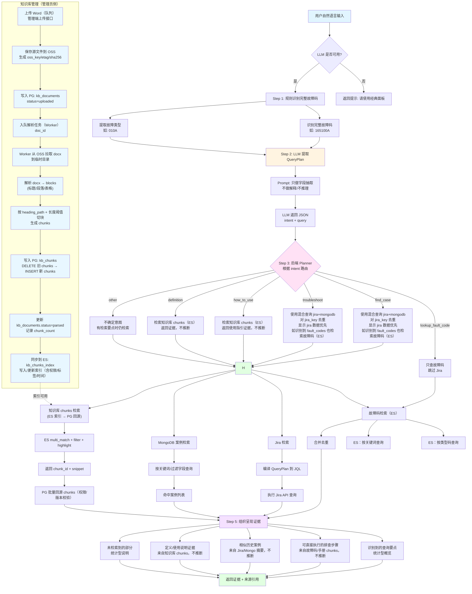

# 智能搜索功能：

区别于现有经典后台管理系统的一个智能搜索板块，目的是用户输入自然语言，会根据数据库的内容给出精确答案；

- 用户登入后跳转到智能搜索页面，完全独立的智能搜索页面，搜索页面参考chatgpt的UI设计
- 分为左侧边栏，中间对话区域，右侧会显示答案展示时的来源区（默认不显示，点击后才展示）
- 智能搜索输入框下侧，有”经典面板“按钮，用于切换到现有的带导航的logtool管理页面；
- 智能搜索页面每个对话限制5个问题，每个问题限制150个字；
- 顶部是logo，新对话-一个独立的按钮，撑满导航栏；历史对话-可折叠展开，底部一个菜单”返回导航面板“ 和 个人信息（和其他页面侧边栏一样）
- 左侧保存用户的历史查询结果，每个用户最多存储5个历史对话，每个历史对话历史对话只以文字形式显示，鼠标悬浮后，显示删除按钮；
- 左侧边栏一级菜单：新对话，历史对话
- 左侧的边栏可折叠，边栏整体颜色浅灰色，折叠按钮 和 logo 在同一行，logo左对齐，折叠按钮右对齐，折叠后鼠标悬浮到logo将原来显示logo的位置显示成折叠按钮，左侧的最底部显示用户名；
- logtool管理页面导航栏第一个一级菜单”智能搜索“切换回独立的智能搜索页面
- 搜索的具体逻辑，智能搜索只限于接入大模型的的情况；当检测未接入大模型或token使用完毕，提示：当前未接入大模型，请经典面板进行搜索
- 总的要求：用户自然语言输入 → 通过**Prompt形式给到大模型** → 意图识别+查询计划 →  LLM返回**QueryPlan，包含了intent（意图）+ query（检索计划）**→ 根据检索计划执行对应数据库的查询 → **答案不生成，只组织呈现证据**（最多做统计型“综合概览”，不推断原因）
- 需要支持多个大模型api，



```

Step 1：先用规则识别故障码（LLM 之前）

- 包含完整故障码（例如165100A），只有故障类型类似 “010A”或”0x010A“，这部分可以参照故障码管理页面的故障码查询功能；

Step 2 :  LLM：只做意图识别+查询计划，

 Prompt

```markdown
"你是查询意图抽取器。只做字段抽取，不做解释、不补充背景、不推理、不写JQL/SQL。",
      "",
      "任务：从用户输入中抽取用户意图(intent)和检索字段(query)。",
      "",
      "输出严格 JSON（不要 Markdown），结构示例：",
      "{",
      "  \"intent\": \"troubleshoot\",",
      "  \"query\": {",
      "    \"fault_codes\": [\"0x010A\"],",
      "    \"symptom\": [\"断网\"],",
      "    \"trigger\": [\"插拔器械\"],",
      "    \"component\": [],",
      "    \"neg\": [],",
      "    \"days\": {{daysFallback}}",
      "  }",
      "}",
      "（示例值仅供参考，实际根据用户输入抽取）",
      "",
      "intent 枚举：",
      "troubleshoot（排查/修复）、lookup_fault_code（查故障码）、find_case（找案例）、definition（概念解释）、how_to_use（使用方法）、other（不确定）",
      "",
      "query 规则：",
      "fault_codes：仅故障类型（010A/0x010A），最后一位 A-E，不要完整码（如165100A）。",
      "symptom/trigger/component/neg：字符串数组，最多12个，每个1-30字符，去掉虚词。",
      "symptom 为故障现象（如\"断网\"、\"无法启动\"）。",
      "trigger 为触发动作（如\"插拔器械\"、\"重启系统\"）。",
      "component 为组件/模块名称（如\"主控制臂\"、\"关节\"、\"驱动器\"、\"IO模块\"）。",
      "neg 为否定项（\"不是断网\"-> neg: [\"断网\"]）。",
      "days：整数，默认 {{daysFallback}}，Jira 回溯天数。",
      "无信息时返回空数组或默认 days。"
```

**intent（意图）**：用户到底要什么

- `troubleshoot`（排查/原因/怎么修）
- `lookup_fault_code`（查某个故障码）
- `find_case`（找历史类似案例）
- `definition`（概念解释/知识性）
- `how_to_use`（怎么使用系统/功能）
- `other`（不确定/无关）

输出结构建议固定为极简 JSON：

```json
{
"intent": "troubleshoot"
"fault_codes": ["0x010A"],
"symptom": ["断网"],
"trigger": ["插拔器械"],
"component": [],
"neg": [],
"days": 180
}
```

Step 3 :  后端 Planner：生成检索策略（AND/OR/高级表达式）

### 1：故障码检索

- 有完整故障码时：使用完整故障码检索
- 只有不完整的故障码：使用故障类型检索code 字段类似 “010A”或”0x010A”，会给出所有子系统下对应的故障；
- 可以借鉴故障码管理页面的故障码查询功能
- 用 LLM返回的`symptom` 做 OR（含同义词）提高召回；按相关度/更新时间排序，**如果使用关键词会导致搜索出的结果噪声过多**
- 关键词查（兜底）：
- 去重（按 id 或 subsystem:code）

### 2：Jira 检索

- **Jira**：默认用 `symptom AND trigger`（提高精度），加上 `updated >= -days`、排序 updated desc、分页。
- 暂不使用同义词库；
- 如果识别到 fault_codes：只提取故障类型 “010A”作为检索条件，而不是完整故障码，类似 “010A”或0x010A，包含了故障类型这种形式的，**把故障类型作为 must 条件之一**（AND）
- AND 所有标识符
- `AND(所有标识符)`

Step 4 :  展现方式（文字回答 + 引用 + 可展开证据 + **查看检索详情**）

回答展现的不需要显示在对话气泡中，直接显示在背景上，参考chatgpt；

分为三个区域

### 1）答案区

**识别到的查询要点（可选一行）**

- 故障码：xxx，现象：断网；触发条件：插拔器械（如果识别到了）。。。。

**故障码解析**

- 如果识别到故障码，显示故障码的**解释（explaination）,**、故障码的**分类**（参考故障码码管理页面中的故障码查询功能）、
- 技术排查步骤
    - 显示对应故障码中的tech_solution 字段，需要包括附件…（引用 [F1]）
    - 附件：图片可预览，pdf显示文件名，可点击，类似故障码管理页面的 技术排查方案修改中的展现方式；

**相似历史案例（来自 Jira ）**

- LOG-1234：摘要…（引用 [J1]）
- LOG-1201：摘要…（引用 [J2]）

**未检索到的部分**

- 未找到“xxxxx”相关内容

---

### 2）来源区、操作区

在答案底部放一个「来源」模块，

- UI交互：来源的标识符号以圆角矩形显示，来源是一个整体按钮，“来源类型”在来源区域以圆形图标重叠显示，例如来源有故障码、JIRA、知识库，只需要”故障码、故障案例、知识库”来源类型重叠显示，未来可能有“故障案例”，来源类型中，故障码标识 显示 为ErrCode, JIRA标识显示 JIRA，知识库显示Knowledge、不需要显示每一个引用；
- 点击后以右侧抽屉展示，抽屉不直接显示在上层，而是压缩对话区域，右侧来源标题：搜索结果
- 来源右侧栏，分区显示，
    - **故障码来源（2）**：`[F1] 0x010A …`、`[F2] 0x020B …`
    - **故障案例来源（5）**：`[J1] LOG-1234 …`、`[J2] LOG-1201 …`,
    - 知识库来源（n）
- 故障码：显示故障码的**解释**、故障码的**参数含义、**故障码的**详细信息 、**故障码的**检查方法、**故障码的**分类**，技术排查步骤、点击后使用故障码管理页面的故障码查询功能的一样的弹窗展示；
- Jira：更完整的摘要 + “跳转 Jira”按钮（VPN 可达跳转，否则展示摘要）
- 知识库：显示对应片段，高亮关键词
- 来源区同一行增加一个复制按钮， 可以将答案复制为文本

UI交互

- LLM返回的 用户意图是find_case 、troubleshoot，而且没有查询到结果时，在对话页面显示一个“故障案例查询“和初始页面中 故障案例卡片一致；
- 意图是lookup_fault_code，而且没有查询到结果时，在对话页面显示一个“故障码查询”卡片和初始页面中 故障案例卡片一致
- LLM返回的 用户意图是 how to use 、definition、others，提示：暂无相关数据，在对话页面显示和初始页面中一样的三个卡片

智能搜索初始页面，显示三个卡片：故障码查询、日志上传、故障案例查询

总体要求
使用Agent代替原来的智能搜索功能，
	整体的前端对话UI不变，来源的展示方式不变（来源变成每次工具调用返回值，当前可以指适配故障码查询的来源，相当于还是用召回的结果做展示？），
	参考agent测试页面支持多轮对话，前端和后端与conversation_id的逻辑需要注意保留；
	支持切换模型
	
	
- 对于后端查询获得的内容需要有明确的来源，来源的显示方式与原来智能搜索功能保持一致；已知可以有明确来源的包括：故障列表、已知案例、知识库、日志
	
应用内的agent支持流式输出
